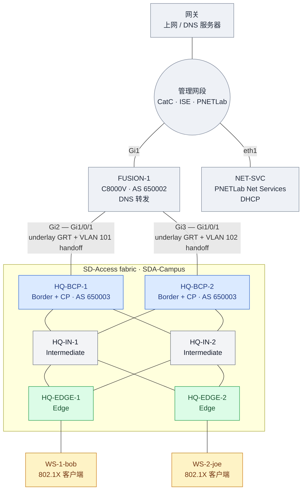

# SD-Access Lab Workbook（Network as Code 版）

用 Catalyst Center + ISE 搭一个 SD-Access fabric。CatC 上的配置（Task 10 起）不点 GUI，用 Terraform 模块 `netascode/nac-catalystcenter` 0.6.0 加 YAML 下发；CatC 管不到的 fusion（Catalyst 8000V）用 `netascode/nac-iosxe` 模块。任务按 NaC 的阶段排列：每个阶段一个配置文件、一次 apply。地址、主机名和参数都按本手册的规划来，照着做就能得到同样的结果。拓扑参考 Mason Reimert 的 SDA workbook v1.0。

状态：✅ 完成 ⏳ 进行中 ⬜ 未开始

## 0. 环境

### 拓扑

地址见下面的「地址规划」。



### 平台

| 项 | 值 |
|---|---|
| 仿真平台 | PNETLab，lab 文件 `/opt/unetlab/labs/sda-workbook/sda-workbook-catc323.unl`；仓库副本 [lab/sda-workbook-catc323.unl](lab/sda-workbook-catc323.unl)（交换机启动配置里的 enable secret 是 `cisco`） |
| 镜像 | 交换机 `cat9kvuadp-17.15.03`（4 vCPU / 18 GB）；FUSION-1 `c8000v-17.16.01a`（2 vCPU / 4 GB）；客户端 `linux-ubuntu-server-20.04`（需自备镜像；默认登录 `root` / `root`；镜像默认用 VNC console（文本 tty，没有剪贴板），lab 文件里已经改成串口 telnet，见 Task 31 第 0 步） |
| Catalyst Center | 3.2.3 |
| ISE | 3.3.0，主机名 `ise.ccie.local`（standalone，PAN/MnT/PSN/pxGrid 同一节点） |
| 域名 | `ccie.local`。DNS 服务器上要有 ISE 的 A 记录，CatC 集成 ISE 时用 FQDN（Task 12） |

### 地址规划

| 用途 | 地址 |
|---|---|
| 管理 / 共享服务 | 192.168.1.0/24 |
| ├ 网关（上网、DNS 服务器） | 192.168.1.1 |
| ├ FUSION-1 Gi1 | 192.168.1.99（也是 NETCONF 管理地址） |
| ├ NET-SVC（PNETLab Net Services） | 192.168.1.98（fabric 客户端的 DHCP，Task 11 附录） |
| ├ Catalyst Center | 192.168.1.133（GUI 和 API：`https://192.168.1.133`） |
| ├ ISE（`ise.ccie.local`） | 192.168.1.221 |
| └ PNETLab | 192.168.1.251 |
| Fusion ↔ Border underlay | 10.0.1.0/24（BCP-1）、10.0.2.0/24（BCP-2）；fusion .1，border 在 Vlan1 上 .2 |
| Border ↔ Intermediate | 172.16.11/12/21/22.0/24（BCP-1–IN-1、BCP-1–IN-2、BCP-2–IN-1、BCP-2–IN-2） |
| Intermediate ↔ Edge | 172.17.11/12/21/22.0/24（IN-1–EN-1、IN-1–EN-2、IN-2–EN-1、IN-2–EN-2） |
| Loopback0（RLOC） | BCP-1/2 9.9.9.11/.12，IN-1/2 9.9.9.21/.22，EDGE-1/2 9.9.9.31/.32 |
| Global pool `SDA-Campus` | 10.254.0.0/16 |
| VLAN 100 客户端（anycast GW .1） | 10.254.100.0/24 |
| L3 handoff BCP-1 / BCP-2（VLAN 101 / 102） | 10.254.251.0/30、10.254.252.0/30 |

### NaC 工具链

| 项 | 值 |
|---|---|
| Terraform | ≥ 1.15（本机 1.17.1） |
| Provider | `CiscoDevNet/catalystcenter` ~> 0.6.6 |
| 模块 | `netascode/nac-catalystcenter/catalystcenter` 0.6.0；`netascode/nac-iosxe/iosxe` 1.0.0（provider `CiscoDevNet/iosxe`，NETCONF） |
| 校验 | `nac-validate data/`（无 schema 时只查语法） |

---

## NaC 构建方法

### 仓库里有什么

| 文件 | 作用 |
|---|---|
| `main.tf` | 连接 CatC 的 provider；调用两个 NaC 模块（CatC 和 FUSION-1）并告诉它们读哪些 YAML（由变量 `stage` 控制，见「怎么分」） |
| `data/0N_*.nac.yaml` | 每个阶段的 YAML：`catalyst_center:` 开头的给 nac-catalystcenter，`iosxe:` 开头的（`00_fusion`、`03_fusion_handoff`）给 nac-iosxe，`ise:` 开头的（`04_ise_policy`）给 nac-ise。一个文件只能有其中一种 |
| `.env.example` | 所有密码的模板；复制成 `.env` 再填（已 gitignore），运行 Terraform 前 `source` |
| `terraform.tfvars.example` | 非敏感参数（CatC 地址），可选 |
| `lab/` | PNETLab 拓扑文件 |

YAML 只写「想要的状态」。模块把 YAML 翻译成 provider 资源，Terraform 把它和 state（上次建成的样子）对比，算出要新增、修改或删除什么，再调 CatC API 执行。

### Provider 和模块

两者是两层：**provider 是 Terraform 和某个平台对话的驱动，模块是写好的一套资源组合**。

| | Provider | 模块（module） |
|---|---|---|
| 是什么 | 插件程序（Go 编译的二进制） | 一个装满 `.tf` 文件的目录（HCL） |
| 管什么 | 怎么调某个平台的 API：登录、建对象、读回状态 | 建哪些资源、它们之间的先后、参数从哪来 |
| 提供什么 | 资源类型，例如 `catalystcenter_building`、`iosxe_bgp_neighbor` | 一套组合好的资源，加上对外的输入（`variable`） |
| 本实验 | `CiscoDevNet/catalystcenter`（CatC REST API）、`CiscoDevNet/iosxe`（设备 NETCONF） | `netascode/nac-catalystcenter`、`netascode/nac-iosxe` |
| 下载到 | `.terraform/providers/` | `.terraform/modules/` |

- **只用 provider 也能干活**：直接写 `resource "catalystcenter_building" ...`，每个参数、每个依赖自己写。
- **模块在 provider 之上再包一层**：NaC 模块读 YAML，翻译成几十上百个 provider 资源，并写好资源之间的 `depends_on`（例如 Stage 2 构建里讲的两道闸）。你描述「要什么」，不用管「调哪个资源、按什么顺序」。
- **模块自己不和设备通信**：它最终生成的还是 provider 资源，真正发 API 请求的始终是 provider。

类比 Ansible：provider 相当于连接插件加 `cisco.ios` 里的 `ios_config` 这类模块，Terraform 的模块相当于一个写好的 role。

**凭据走哪一层**，是这层关系最容易绕晕的地方：

- **provider 的登录凭据**：一般在根目录 `main.tf` 的 `provider` 块里配，模块沿用。CatC 就是这样，nac-catalystcenter 模块里没有 provider 块；provider 也能直接读环境变量 `CC_USERNAME` / `CC_PASSWORD`。
- **例外**：nac-iosxe 在模块**内部**自己写了 `provider "iosxe"` 块，根目录的配置进不去，凭据只能走 provider 自己读的环境变量 `IOSXE_USERNAME` / `IOSXE_PASSWORD`。
- **资源参数里的密码**：ISE 的管理员密码和 RADIUS 共享密钥不是 provider 登录用的，而是 CatC 拿去登录 ISE 的参数，所以要走模块的输入：YAML 里用 `!env ISE_PASSWORD` 从环境变量读，由模块交给 provider 资源。

三类都是环境变量，所以所有密码统一放在 gitignore 的 `.env` 里（模板 `.env.example`），运行 Terraform 前加载（每个新终端一次）：

```bash
set -a; source .env; set +a
```

环境变量不会写进 state，也不会写进 `.tfplan`。

### 为什么分阶段

Terraform 按资源之间的依赖排顺序，没有依赖的资源并行创建。模块里写好的依赖它知道（比如 building 在 area 之后建），但模块没有让 AAA 设置等 ISE 集成完成（`catalystcenter_aaa_settings` 的 `depends_on` 里没有 ISE 的资源）。而 CatC 要求 ISE 已集成才能设为 AAA，两者放在一次 apply 里会并行创建，AAA 先到就失败。

所以把有先后要求的对象分到不同阶段，前一阶段 apply 完、验证通过，再做下一阶段。顺带的好处是每次 apply 的范围小，plan 容易看懂，出了错也容易定位。

### 怎么分

`main.tf` 的变量 `stage` 决定读入哪些 YAML：Stage N 读入第 1 到 N 个文件。阶段是累加的，后面的阶段仍然包含前面的配置，已经建好的部分在 plan 里显示为无变化。`stage` 默认是 4（当前最后一个阶段）。

| Stage | Task | 配置文件 | Plan 文件 |
|---|---|---|---|
| Stage 0 | Task 0 实验准备；Task 1–6 underlay 与纳管；Task 7 FUSION-1；Task 8 构建 | underlay 在 lab 启动配置里，Task 5 手工 CLI，Task 6 CatC GUI；FUSION-1 用 `data/00_fusion.nac.yaml`（nac-iosxe） | `stage0.tfplan` |
| Stage 1 | Task 9 CatC 应用包（GUI）；Task 10 网络层级、Task 11 地址池、Task 12 集成 ISE；Task 13 构建 | `data/01_sites_pools.nac.yaml` | `stage1.tfplan` |
| Stage 2 | Task 14 AAA、Task 15 设备分配和 provision；Task 16 构建 | `data/02_aaa_devices.nac.yaml` | `stage2.tfplan` |
| Stage 3 | Task 17–21 transit、VN、fabric site、设备角色、anycast gateway；Task 22 构建 | `data/03_fabric.nac.yaml` + `data/03_fusion_handoff.nac.yaml`（fusion 一侧） | `stage3.tfplan` |
| Stage 4 | Task 23 策略归属（不改配置）；Task 24–28 SGT 策略、身份组、用户、授权、policy set；Task 29 端口（NaC）、Task 30 构建、Task 31 客户端（手工）、Task 32 验证 | `data/04_ise_policy.nac.yaml`（nac-ise）+ `data/04_host_onboarding.nac.yaml`（CatC 端口） | `stage4.tfplan` |

### 每个阶段怎么做

流程固定四步：

```bash
terraform plan -var stage=N -out stageN.tfplan   # 1. 生成 plan，存成文件
terraform show stageN.tfplan | less -R           # 2. 检查：只应有新增，0 to change、0 to destroy
terraform apply stageN.tfplan                    # 3. 按检查过的 plan 执行
terraform plan -var stage=N                      # 4. 确认 No changes
```

- 第 3 步用存下来的 plan 文件，保证执行的就是第 2 步看过的内容。
- **已经建好的环境不要把 `stage` 调小**：少读的文件里的对象会被 plan 成删除。第 2 步看到 destroy 就停下。
- `*.tfplan` 已 gitignore，apply 后就过期（state 变了 Terraform 会拒绝再用），可随时删除。
- 构建（plan 和 apply）也是 Task，按 Task 顺序做下来就是完整的搭建过程。每个构建 Task 写了前提、plan 里应该出现什么、apply 之后怎么验证。第一次用 Terraform 前要准备 `.env` 并 `terraform init`，步骤在 Task 8。

### 约定

- **greenfield**：从一台刚部署好、只完成了 Stage 0 的 CatC 开始，站点、地址池、fabric 等全部由 Terraform 创建，不在 GUI 里手工建。
- **凭据**：Terraform 读取的密码放在 gitignore 的 `.env`（见「Provider 和模块」）；这是教学实验，WORKBOOK 里直接写出了实验用的账号和密码。
- **state 不进仓库**：`terraform.tfstate` 已 gitignore，里面有 CatC 返回的对象 ID 等信息，放进公开仓库不合适。

---

## Stage 0 – Underlay、设备纳管与 FUSION-1（CLI / NaC）

Task 2–4 的交换机配置（IS-IS、border 上的 BGP 和重分发）已经写在 lab 文件的启动配置里：导入 [lab/sda-workbook-catc323.unl](lab/sda-workbook-catc323.unl)、第一次启动交换机，underlay 就是建好的状态。下面逐段讲解这些配置，并给出验证方法。Task 5 是纳管前的准备，要在每台交换机上手工做。

### ✅ Task 0 – 实验准备

**目标**：开始 Task 1 之前，lab 文件之外的组件都就位，按顺序启动并确认互通。

**lab 文件里有的**：6 台 Cat9000v、FUSION-1、两台 Ubuntu 客户端、NET-SVC，以及它们之间的连线和两个 cloud（LAN 接 192.168.1.0/24，NAT 给客户端上网）。交换机的启动配置里已经有 underlay（Task 2–4）。

**要自己准备的**：

| 组件 | 要求 |
|---|---|
| PNETLab 主机 | 192.168.1.251，本实验是 27H1 v8.2；LAN cloud 桥接到 192.168.1.0/24 |
| PNETLab 镜像 | `cat9kvuadp-17.15.03`、`c8000v-17.16.01a`、`linux-ubuntu-server-20.04`（需自备）；Net Services 的 Docker 镜像在 Task 11 附录里装 |
| Catalyst Center | 3.2.3，装好并能登录 GUI，地址 192.168.1.133 |
| ISE | 3.3，standalone，地址 192.168.1.221，主机名和域名的要求见 Task 12 |
| 网关 192.168.1.1 | 上网和 DNS；DNS 上要有 `ise.ccie.local` 的 A 记录（Task 12） |
| 自己的电脑 | 能访问 192.168.1.0/24；装好 Terraform（≥ 1.15）、git、telnet 客户端；克隆本仓库 |

**顺序**：

1. 先开 CatC 和 ISE，它们启动最慢，等 GUI 能登录。
2. 在 PNETLab 主机上打 Net Services 需要的补丁（Task 11 附录「默认：PNETLab Net Services」第 2 步）。这一步要重启 PNETLab 的 broker，在 lab 节点启动之前做。
3. PNETLab → Import，导入 [lab/sda-workbook-catc323.unl](lab/sda-workbook-catc323.unl)。
4. 启动 FUSION-1 和 6 台交换机。客户端和 NET-SVC 可以等到 Task 11、Task 31 再开。

**验证**：

```bash
ping -c 3 192.168.1.133              # CatC
ping -c 3 192.168.1.221              # ISE
dig +short ise.ccie.local @192.168.1.1   # 192.168.1.221
```

交换机 console 能连上（端口在 PNETLab 节点右键菜单的 Console 里看），提示符是 `HQ-BCP-1#` 这类主机名，说明启动配置已经加载。

### ✅ Task 1 – 数据中心路由

**目标**：共享服务网段（CatC、ISE 所在的 192.168.1.0/24）和 fabric 之间互相可达。

共享服务直接在管理网段上。FUSION-1 的 Gi1 接入这个网段，默认路由指向 192.168.1.1，并在 BGP 里把 192.168.1.0/24 宣告给 border。这些都是 FUSION-1 上的配置，在 Task 7 的 `data/00` 里，交换机上不用配。

回程方向：管理网段的网关（192.168.1.1）上没有去 fabric 的路由，所以 CatC 和 ISE 各自加两条经 FUSION-1 的静态路由，分别去交换机的 Loopback0（RLOC）和客户端地址：

| 目的 | 下一跳 |
|---|---|
| 9.9.9.0/24 | 192.168.1.99 |
| 10.254.0.0/16 | 192.168.1.99 |

ISE 在 CLI 的 config 模式里加：

```text
ise/admin(config)# ip route 9.9.9.0 255.255.255.0 gateway 192.168.1.99
ise/admin(config)# ip route 10.254.0.0 255.255.0.0 gateway 192.168.1.99
```

CatC 的静态路由在安装向导（maglev configuration wizard）里给接入 192.168.1.0/24 的那块网卡配置；装好之后要改，用 `sudo maglev-config update` 重新走向导。

> [!NOTE]
> 9.9.9.0/24 是公网地址段（Quad9 DNS 就在里面），本实验的 RLOC 用的就是这一段。CatC 和 ISE 上有这条更具体的静态路由，所以不会走到公网；但在没有这条路由的机器上 ping 9.9.9.x 也会通，那是公网的回应，不代表能到 fabric。

### ✅ Task 2 – Fusion 路由

**目标**：Fusion（AS 650002）和两台 border（AS 650003）在 GRT 建 eBGP，只做 underlay 可达，不涉及 overlay VN。

fusion 一侧由 Task 7 的 `data/00` 下发。border 一侧在启动配置里（HQ-BCP-2 的邻居是 10.0.2.1，宣告 9.9.9.12）：

```text
router bgp 650003
 bgp router-id interface Loopback0
 bgp log-neighbor-changes
 neighbor 10.0.1.1 remote-as 650002
 address-family ipv4
  network 9.9.9.11 mask 255.255.255.255
  neighbor 10.0.1.1 activate
 exit-address-family
```

border 到 fusion 的链路是 Gi1/0/1 trunk 加 Vlan1（10.0.1.2 / 10.0.2.2），也在启动配置里。

**验证**（Task 7 FUSION-1 配好之后）：两个邻居 Established。

```text
FUSION-1# show ip bgp summary
```

### ✅ Task 3 – Fabric 内部 underlay

**目标**：所有 fabric 内链路和 Loopback0 跑 IS-IS，loopback 全互通。

**原理**：SD-Access 的 underlay 只要求 RLOC（Loopback0 /32）可达、MTU 足够（VXLAN 多 50 字节）。IS-IS 是 LAN Automation 默认用的协议，不依赖 IP 就能起邻居。

6 台都是同一个模式：NET 的系统 ID 取 Loopback0 的最后一段（9.9.9.31 → `0000.0000.0031`），Loopback0 和每条 fabric 链路上开 IS-IS，链路是点到点。以 HQ-EDGE-1 为例：

```text
interface Loopback0
 ip address 9.9.9.31 255.255.255.255
 ip router isis
interface GigabitEthernet1/0/1
 description TO-HQ-IN-1
 no switchport
 ip address 172.17.11.2 255.255.255.0
 ip router isis
 isis network point-to-point
router isis
 net 49.0001.0000.0000.0031.00
 metric-style wide
 log-adjacency-changes
```

**验证**：IS-IS 邻居都是 Up；从任意节点 ping 其他节点的 Loopback0（9.9.9.x）都通。

```text
HQ-EDGE-1# show isis neighbors
HQ-EDGE-1# ping 9.9.9.11 source Loopback0
```

### ✅ Task 4 – 重分发

**目标**：border 上 IS-IS ↔ BGP 双向重分发，并把 border 自己的 loopback 宣告进 BGP（它们是本地直连，不会经 IS-IS 重分发出来）。

border 的启动配置里，在 Task 2、Task 3 的基础上多了这两行（宣告 loopback 的 `network` 已经在 Task 2 里）：

```text
router isis
 redistribute bgp 650003
router bgp 650003
 address-family ipv4
  redistribute isis level-1-2
```

**验证**：从 edge 的 Loopback0 ping 通 CatC 和 ISE。

```text
HQ-EDGE-1# ping 192.168.1.133 source Loopback0
HQ-EDGE-1# ping 192.168.1.221 source Loopback0
```

### ✅ Task 5 – 设备引导

**目标**：让 CatC 能纳管 fabric 节点：SNMP、本地最高权限账号 `dna` / `ISEisC00L`、VTY 只允许 SSH、NETCONF。hostname 和 `ip domain name ccie.local` 已经在启动配置里。

在 6 台交换机（BCP、IN、EDGE）的 console 上各粘贴一次：

```text
configure terminal
username dna privilege 15 secret ISEisC00L
aaa new-model
aaa authentication login default local
aaa authentication login CONSOLE none
aaa authorization exec default local
line con 0
 login authentication CONSOLE
line vty 0 15
 privilege level 15
 transport input ssh
exit
crypto key generate rsa modulus 2048
ip ssh version 2
snmp-server community cisco RO
netconf-yang
end
write memory
```

- 先建账号再开 AAA；`CONSOLE` 方法列表让 console 继续免登录，否则开了 `aaa new-model` 之后 console 也要输账号。
- `crypto key generate` 要跑一会儿，后面几行可能落在 exec 模式里报错，跑完再补。
- CatC Discovery 只需要 SNMP 读权限，所以 community 是 RO。

**验证**：在一台交换机上用 `dna` SSH 到另一台的 Loopback0，NETCONF 是 running。

```text
HQ-BCP-1# ssh -l dna 9.9.9.31
HQ-BCP-1# show netconf-yang status
```

### ✅ Task 6 – 发现设备

**目标**：用 CatC Discovery 把 6 台交换机加入 inventory。

CatC → Provision → Inventory → Add Device → Discovery，按下表新建一次 discovery：

| 字段 | 值 |
|---|---|
| Discovery Type | IP Address/Range |
| IP 范围 | `9.9.9.11` – `9.9.9.32` |
| Preferred Management IP | Use Loopback |
| CLI | 用户名 `dna`，密码 `ISEisC00L`，enable 密码 `cisco` |
| SNMPv2c Read | community `cisco` |
| NETCONF | 端口 830 |

**验证**：Inventory 里 6 台（HQ-BCP-1/2、HQ-IN-1/2、HQ-EDGE-1/2）都是 Reachable、Managed，设备名带域名（例如 `HQ-BCP-1.ccie.local`，Task 15 按这个名字找设备）。

### ✅ Task 7 – FUSION-1（Catalyst 8000V，nac-iosxe）

**目标**：fusion 用 NaC 管理：管理网段接入、默认路由、和两台 border 的 underlay eBGP、给 fabric 客户端的 DNS 转发。到 border 的 L3 handoff（子接口和 VRF CORP 的邻居）在 Stage 3（Task 20）。

**为什么是 C8000V**：fusion 在 fabric 外，CatC 不管它。NaC 管 IOS-XE 用 `netascode/nac-iosxe` 模块，底层的 `CiscoDevNet/iosxe` provider 走 NETCONF（或 RESTCONF），需要 IOS-XE 17.x；经典 IOS（IOL 15.x）两者都没有。

**Day-0 bootstrap（console，一次性）**：NaC 要靠 NETCONF 连设备，而设备得先有管理地址、账号和 NETCONF，这一步只能在 console 上做。

1. 首次开机问 `Would you like to enter the initial configuration dialog?` 答 `no`。17.x 随后要求设置 enable secret，本实验设为 `cisco`，设完选 `2` 保存退出。
2. 建本地账号 `admin` / `Cisco123...`（`.env` 里的 `IOSXE_USERNAME` / `IOSXE_PASSWORD` 填同样的值）：

   ```text
   enable
   configure terminal
   username admin privilege 15 secret Cisco123...
   ```

3. 其余部分，同样在 FUSION-1 的 console 上整段粘贴（账号建好之后再开 AAA，否则 console 会被锁在外面）：

   ```text
   pnpa service discovery stop          ! exec 模式；停掉开机自带的 PnP 发现
   configure terminal
   hostname FUSION-1
   ip domain name ccie.local
   interface GigabitEthernet1
    ip address 192.168.1.99 255.255.255.0
    no shutdown
   exit
   ip route 0.0.0.0 0.0.0.0 192.168.1.1
   crypto key generate rsa modulus 2048
   ip ssh version 2
   line vty 0 4
    transport input ssh
   exit
   aaa new-model
   aaa authentication login default local
   aaa authorization exec default local
   netconf-yang
   end
   write memory
   ```

   `crypto key generate` 要跑一会儿，粘贴时后面几行可能落在 exec 模式里报错，跑完再补。NETCONF 依赖 `aaa new-model`，开启后要等一两分钟 830 端口才通，在自己的电脑上检查：

   ```bash
   nc -z 192.168.1.99 830
   ```

**NaC**：`data/00_fusion.nac.yaml`，根键是 `iosxe:`，设备用 `host` 指向管理地址：

```yaml
iosxe:
  devices:
    - name: FUSION-1
      host: 192.168.1.99
      templates: [fusion-dns]
      configuration:
        interfaces:
          ethernets:
            - type: GigabitEthernet
              id: "2"
              description: TO-HQ-BCP-1
              ipv4: { address: 10.0.1.1, address_mask: 255.255.255.0 }
        routing:
          static_routes:
            - prefix: 9.9.9.0           # fabric loopback 汇总，学不到的丢弃
              mask: 255.255.255.0
              next_hops:
                - interface_type: "Null"  # 要加引号，否则 YAML 当成空值
                  interface_id: "0"
          bgp:
            as_number: 650002
            neighbors:
              - { ip: 10.0.1.2, remote_as: 650003 }
            address_family:
              ipv4_unicast:
                networks:
                  - network: 192.168.1.0  # 有类 /24，IOS 不存掩码，这里也不写
                neighbors:
                  - ip: 10.0.1.2
```

- 数据模型里没有的 `ip dns server`（给客户端做 DNS 转发）用 CLI 模板（`type: cli`）原样下发。
- 一个 YAML 文件只能有一个根键（`iosxe:` 或 `catalyst_center:`），所以 fusion 的配置单独成文件，`main.tf` 给两个模块分别传文件列表。

**验证**：两个 BGP 邻居 Established，BGP 路由里有 9.9.9.11–32 六条 /32；CatC Inventory 里设备恢复 Reachable。

```text
FUSION-1# show ip bgp summary
FUSION-1# show ip route bgp
```

### ✅ Task 8 – 构建（Stage 0）

前提：Task 1–6 完成，FUSION-1 做完 day-0 bootstrap。

**1. 准备 `.env`**（只在第一次做）

```bash
cp .env.example .env
```

| 变量 | 填什么 |
|---|---|
| `CC_USERNAME` / `CC_PASSWORD` | CatC 管理员账号（SUPER-ADMIN-ROLE） |
| `ISE_USERNAME` / `ISE_PASSWORD` | Task 12 准备第 6 步的 ISE 管理员账号 |
| `ISE_SHARED_SECRET` | RADIUS 共享密钥，自己定一个随机字符串。CatC 会把它同时写进交换机的 `radius server` 配置和 ISE 的 Network Device，两边自动一致，不用记 |
| `IOSXE_USERNAME` / `IOSXE_PASSWORD` | FUSION-1 上 bootstrap 建的本地账号 |

`.env` 已 gitignore。CatC 地址在 `main.tf` 有默认值，要改就复制 `terraform.tfvars.example`。

**2. 初始化**（只在第一次做，或模块、provider 版本变了之后）

```bash
terraform init        # 下载 provider 和两个 NaC 模块
terraform validate    # 检查语法
```

**3. Plan、检查、apply**（每个阶段、每个新终端都先加载 `.env`）

```bash
set -a; source .env; set +a
terraform plan -var stage=0 -out stage0.tfplan
terraform show stage0.tfplan | less -R
terraform apply stage0.tfplan
terraform plan -var stage=0     # 只剩 iosxe_commit 一项 change
```

plan 里应有 15 个新增，全是 `module.iosxe`：`iosxe_system`、3 个 `iosxe_interface_ethernet`、2 条 `iosxe_static_route`、`iosxe_bgp` 和地址族、2 × 2 个 BGP 邻居资源、`iosxe_dhcp`、`iosxe_cli`（CLI 模板）、`iosxe_commit`。

`iosxe_commit` 是「保存配置」这个动作（`save_config = true`，相当于 `write memory`），每次 plan 都显示 1 个 change，属于设计如此，其余资源应无变化。


---

## Stage 1 – 站点、地址池与 ISE 集成（`data/01_sites_pools.nac.yaml`）

### ✅ Task 9 – CatC 应用包（GUI，一次性）

新装的 CatC 只有核心包，fabric 相关的功能（fabric site、transit、VN 等）在 **SD Access** 包里。没装就跑 Stage 3，CatC 会直接拒绝：

```text
NCSP11008: Package required to process the request was not found.
No application found for type 'ConnectivityDomain' and qualifier 'null'.
```

NaC 管不了这一步：provider 和模块用的是 CatC 公开的 Intent API（站点、设备、fabric、策略），装应用包属于 CatC 平台自身的生命周期，走 maglev 内部的系统 API，没有公开。和 ISE、C8000V 的 day-0 一样，只能手工做一次。

1. System → Software Management → Available Applications，勾选 **SD Access**（分类 Automation）→ Install。依赖包会一起装上，CatC 要能访问 Internet 下载。
2. 进度看 **View Release Activities** → 点执行 ID：依次是 Get Install release、Download Artifacts、Install Package。主页面上的百分比更新很慢，可能长时间停在 1%，以这里的步骤为准。
3. 也可以在这一步顺手装后面要用的包，例如 Group Based Policy Analytics（Stage 4 可选）。

> [!WARNING]
> 安装约需 1 小时，大部分时间花在 Install Package，期间 CatC 会逐个停掉、更新再拉起内部服务。安装完成前不要开始 Stage 3：部分 Intent API 会返回 502，Terraform plan 报 `StatusCode 502`，而 System 360 仍显示全部健康（被停掉的服务不在列表里）。以 View Release Activities 里这次安装变成 **Success** 为准。

**验证**：View Installed Applications 里有 SD Access；左侧菜单 Provision → SD-Access 下的 Fabric Sites、Transits 能打开；System 360 里服务全部正常。

### ✅ Task 10 – 网络层级

**目标**：Area `USA` → Building `SDA-Campus`。

```yaml
catalyst_center:
  sites:
    areas:
      - name: USA
        buildings:
          - name: SDA-Campus
            country: United States   # provider 必填
            latitude: 37.41          # CatC 要求经纬度或地址二选一（NCND10502）
            longitude: -121.95
```

**原理**：模块把树展开成 `Global/USA`、`Global/USA/SDA-Campus`。`managed_sites` 为空且 `manage_global_settings: false` 时，YAML 里出现的所有站点都会被管理。

### ✅ Task 11 – IP 地址池

*地址池只依赖站点，和站点放在同一个文件、同一阶段下发。*

**目标**：Global pool `SDA-Campus` 10.254.0.0/16，Building 下预留三个子池。

```yaml
catalyst_center:
  sites:
    global:
      network_settings:
        ip_pools:
          - name: SDA-Campus
            ip_address_space: IPv4
            ip_pool_cidr: 10.254.0.0/16
    areas:
      - name: USA
        buildings:
          - name: SDA-Campus
            network_settings:
              ip_pools_reservations:
                - name: SDA-Campus-VLAN-100
                  global_pool: SDA-Campus
                  subnet: 10.254.100.0
                  prefix_length: 24
                  gateway: 10.254.100.1
                  dhcp_servers: [192.168.1.98]
                  dns_servers: [192.168.1.99]
                - name: SDA-Campus-L3-Handoff-1
                  global_pool: SDA-Campus
                  subnet: 10.254.251.0
                  prefix_length: 30
                - name: SDA-Campus-L3-Handoff-2
                  global_pool: SDA-Campus
                  subnet: 10.254.252.0
                  prefix_length: 30
```

客户端用 DHCP，服务器是 PNETLab 的 Net Services 节点 NET-SVC（192.168.1.98，见下）。

#### 附：DHCP 服务器

**为什么放在 fabric 外**：SD-Access 的 DHCP 服务器一般在 fabric 外的共享服务区。流程：

1. Edge 作为 relay，GIADDR 填 anycast gateway（10.254.100.1），插入 option 82（含 edge 的 RLOC）；
2. 服务器按 GIADDR 选池，回包时**原样带回 option 82**；
3. Border 收到回包，根据 option 82 里的 RLOC 送回正确的 edge（因为所有 edge 共用同一个 GIADDR）。

edge 插入的 option 82 有两个子选项：Circuit-ID（子选项 1）里是 VLAN 和端口（例如 `00 04 00 64 01 07`：VLAN 100、端口 1/0/7），Remote-ID（子选项 2）里带着 edge 的 RLOC（例如 HQ-EDGE-2 的 `09 09 09 20`，即 9.9.9.32）。

所以 DHCP 服务器要满足三条：

- 接受经 relay 过来的请求，按 GIADDR 选地址池（服务器自己不在 10.254.100.0/24 里）；
- 回包原样带回 option 82；
- 有去 10.254.100.0/24 的路由，下一跳是 FUSION-1（192.168.1.99），Stage 3 之后 FUSION-1 经 handoff 学到这个网段。网关 192.168.1.1 上没有这条路由。

本实验用 PNETLab 自带的 Net Services；下面另给两种备选。dnsmasq（Net Services 和备选 A 都是它）和 IOS 的 DHCP server 都实测过会原样带回 option 82。

##### 默认：PNETLab Net Services

Net Services 是 PNETLab 的 Docker 节点（镜像 `rspnet/pnet-services`，里面是 dnsmasq，带 Web 管理界面）。它的 DHCP scope 有 giaddr 字段，专门服务 `ip helper-address` 后面的客户端。在 Task 31 之前做好即可。

1. **装镜像**：PNETLab → Docker Devices → Net Services → Install。
2. **给模板加 NET_ADMIN**（在 PNETLab 主机上做一次；在 PNETLab 27H1 v8.2、软件包 `pnetlab` 6.8.62 上验证过）。dnsmasq 开 DHCP 必须有 NET_ADMIN，而 PNETLab 的 broker 只按模板 YAML 给容器加权限，节点设置里的 Docker options 不生效：

   先确认要改的那一行存在（应输出一行；没有输出说明版本不同，不要照抄下面的命令）：

   ```bash
   sudo grep -n 'gui = not dock_args and not isinstance(tpl.get("docker"), dict)' /opt/unetlab/scripts/pnetlab-brokerd.py
   ```

   然后备份、修改、重启 broker：

   ```bash
   sudo cp -p /opt/unetlab/scripts/pnetlab-brokerd.py /opt/unetlab/scripts/pnetlab-brokerd.py.bak
   sudo cp -p /opt/unetlab/html/templates/intel/services.yml /opt/unetlab/scripts/services.yml.bak
   sudo sed -i 's/gui = not dock_args and not isinstance(tpl.get("docker"), dict)/gui = not dock_args/' /opt/unetlab/scripts/pnetlab-brokerd.py
   grep -q '^docker:' /opt/unetlab/html/templates/intel/services.yml || printf 'docker:\n  cap_add: [NET_ADMIN]\n' | sudo tee -a /opt/unetlab/html/templates/intel/services.yml
   sudo systemctl restart pnetlab-brokerd
   ```

   - 第一处改的是 broker 判断「GUI 类 Docker 节点」的条件。原版只要模板里有 `docker:` 块，就不再发布 console 端口，Net Services 的 HTTP 管理界面会打不开；改成只看 `dock_args`。PNETLab 自带的模板没有用 `docker:` 块的，其他节点不受影响。
   - `NET_ADMIN` 在 broker 的免签名允许名单里，不需要 `pnetlab-template-sign`。AMD 主机改 `templates/amd/services.yml`。
   - 重启 broker 会断开正在运行的节点的 console 转发，所以在 lab 节点都停着的时候做。升级 pnetlab 软件包后这两处可能被覆盖，要重新做。
   - 恢复原样：

     ```bash
     sudo cp -p /opt/unetlab/scripts/pnetlab-brokerd.py.bak /opt/unetlab/scripts/pnetlab-brokerd.py
     sudo cp -p /opt/unetlab/scripts/services.yml.bak /opt/unetlab/html/templates/intel/services.yml
     sudo systemctl restart pnetlab-brokerd
     ```
3. **节点**：仓库里的 lab 文件已经带有 NET-SVC 节点，设置如下表，eth1 接在 LAN cloud 上，导入后直接 Start。自己从空白 lab 搭的话，Add node → Net Services 按表填。

   | 字段 | 值 |
   |---|---|
   | Name | `NET-SVC` |
   | RAM (MB) | 512 |
   | Eth1 ip | `192.168.1.98/24` |
   | Default route | `192.168.1.99` |
   | DNS | `192.168.1.1` |

   默认路由指向 FUSION-1，因为 DHCP 回包发往 giaddr 10.254.100.1：网关 192.168.1.1 上没有去 fabric 的路由，FUSION-1 有（Stage 3 的 handoff）。节点设置里只能填默认路由，容器里手工加的静态路由重启后就没了。

   在 PNETLab 主机上确认容器拿到了 NET_ADMIN（`docker<N>` 的 N 是节点的 console 端口减 30000）：

   ```bash
   sudo docker inspect docker21 --format '{{.HostConfig.CapAdd}}'   # [CAP_NET_ADMIN]
   ```

4. **建 scope**：打开节点的 console（HTTP，登录 `admin` / `pnet`；本实验是 `http://192.168.1.251:30021`，端口由 PNETLab 分配，在节点右键菜单的 Console 里看）→ DHCP → Add scope：

   | 字段 | 值 |
   |---|---|
   | Scope name | `SDA-VLAN100` |
   | Lab interface | `eth1` |
   | Subnet | `10.254.100.0/24` |
   | Lease duration | `12h` |
   | Pool start / end | `10.254.100.100` / `10.254.100.200` |
   | Default gateway | `10.254.100.1` |
   | DNS servers | `192.168.1.99` |
   | Domain name | `ccie.local` |
   | Relay address (giaddr) | `10.254.100.1` |

   勾选 **Serve this scope** 和 **I confirm no other DHCP server should answer on this interface**，Save scope。Overview 页里 dnsmasq 显示 **running**。

   eth1 所在的 192.168.1.0/24 上原本就有网关的 DHCP，两者不冲突：这个 scope 只发 10.254.100.0/24 的地址，这个网段的请求只会经 edge relay 过来。

5. **验证**（Task 31 客户端拿到地址之后）：Net Services → DHCP：**Active leases** 里客户端的 Scope 是 `SDA-VLAN100`、Relay 是 `10.254.100.1`；**DHCP activity** 里 ACK 的明细有 `82 agent-id 01:06:00:04:00:64:01:07:02:0a:03:08:00:10...`，即 Circuit-ID 和 Remote-ID 原样带回。edge 上的 helper：

   ```text
   HQ-EDGE-1# show running-config interface Vlan100 | include helper
    ip helper-address 192.168.1.98
   ```

##### 备选 A：Linux 主机 / VM 跑 dnsmasq

任何能放在 192.168.1.0/24 上的 Linux 都行（PNETLab 里的 Linux 节点接 LAN cloud，或者外面的一台 VM）。以 Ubuntu 20.04 为例，假设它的地址是 192.168.1.97：

```bash
apt install -y dnsmasq
ip route add 10.254.100.0/24 via 192.168.1.99      # 永久生效要写进 netplan 的 routes
cat > /etc/dnsmasq.d/sda.conf <<'EOF'
port=0
interface=eth0
dhcp-range=10.254.100.100,10.254.100.200,255.255.255.0,12h
dhcp-option=3,10.254.100.1
dhcp-option=6,192.168.1.99
dhcp-option=15,ccie.local
log-dhcp
EOF
systemctl restart dnsmasq
```

- `port=0` 关掉 DNS，避免和 systemd-resolved 抢 53 端口。
- 只有 10.254.100.0/24 一个地址池，所以 192.168.1.0/24 上本地广播的 DHCP 请求它不会回应，不会和网关的 DHCP 冲突。
- 地址池改成 `dhcp_servers: [192.168.1.97]`，再按下面「中途更换 DHCP 服务器」让 helper 生效。`journalctl -u dnsmasq` 里能看到 `DHCPACK(eth0) 10.254.100.x`；用 `tcpdump -n -v -i eth0 udp port 67` 可以看到 OFFER / ACK 里带回的 `Agent-Information Option 82`。

##### 备选 B：家用路由器的 DHCP

条件是上面三条都要满足：路由器的 DHCP 能为不在自己 LAN 上的网段（10.254.100.0/24）建地址池、接受 relay 过来的请求、带回 option 82，并且能加静态路由 10.254.100.0/24 → 192.168.1.99。多数家用固件的 DHCP 只服务自己的 LAN，做不到；OpenWrt 这类底层就是 dnsmasq 的固件，可以按备选 A 的 `dhcp-range` / `dhcp-option` 配置。本实验没有验证过这种做法。地址池改成 `dhcp_servers: [192.168.1.1]`，再按下面「中途更换 DHCP 服务器」让 helper 生效。

##### 中途更换 DHCP 服务器

按本手册的顺序从头建，Stage 1 建地址池时 DHCP server 就已经是 192.168.1.98，用不到这一节。只有建好之后再换服务器（比如改用备选 A / B）时才需要：

改了地址池的 DHCP server 之后，CatC 只更新地址池对象，不会自动把 edge 上的 `ip helper-address` 改掉。要再「Reconfigure Fabric Site」（GUI：Provision → SD-Access → Fabric Sites）；NaC 里是在 fabric site 下临时加 `reconfigure: true`，模块会建一个 `catalystcenter_apply_pending_fabric_events`，apply 之后 edge 上的 helper 才会变（1–2 分钟）。确认两台 edge 都变了之后删掉这一行再 apply 一次，这个资源只从 state 里删掉。如果它几秒就结束、helper 没变，说明 CatC 还没生成待处理的事件，等半分钟后加上 `-replace='module.catalyst_center.catalystcenter_apply_pending_fabric_events.fabric_pending_events["Global/USA/SDA-Campus"]'` 再跑一次。

### ✅ Task 12 – 集成 ISE

*CatC 的全局系统设置，不依赖站点和地址池，和 `data/01` 同一阶段 apply；Stage 2 的 AAA 设置要求 ISE 已集成。*

**目标**：ISE 开 pxGrid，CatC 里加 ISE 为 AAA/PAN，重新 provision 后设备出现在 ISE 的 Network Devices 里。

**NaC**：`data/01_sites_pools.nac.yaml` 的 `system_settings`，凭据从 `.env` 读。

```yaml
catalyst_center:
  system_settings:
    authentication_and_policy_servers:
      ise:
        ip_address: 192.168.1.221
        fqdn: ise.ccie.local          # 必须和 ISE 证书的 CN 一致
        username: !env ISE_USERNAME
        password: !env ISE_PASSWORD
        password_version: 1
        shared_secret: !env ISE_SHARED_SECRET
        shared_secret_version: 1
        pxgrid_enabled: true
        retries: 3
        timeout: 4
        protocols:
          radius:
            authentication_port: 1812
            accounting_port: 1813
```

模块据此生成两个资源（[cc_system_settings.tf#L7-L51](https://github.com/netascode/terraform-catalystcenter-nac-catalystcenter/blob/v0.6.0/cc_system_settings.tf#L7-L51)），对应 GUI 里的两步：

- `catalystcenter_authentication_policy_server`：相当于 System → Settings → External Services → Authentication and Policy Servers → Add → ISE。填 ISE 的 IP 和 FQDN、RADIUS 端口、RADIUS 共享密钥、ISE 管理员账号，并打开 pxGrid。CatC 用这个账号登录 ISE，交换证书、建立信任。
- `catalystcenter_integrate_ise`：相当于 GUI 里弹出 ISE 证书时点「Accept」。接受证书后 CatC 和 ISE 完成 pxGrid 连接。

**凭据怎么传**：YAML 在公开仓库里，所以 ISE 的用户名、密码和 RADIUS 共享密钥用 `!env` 从环境变量读（值在 `.env`）。

- YAML 里写了 `password_version` 和 `shared_secret_version`，模块就改用 write-only 参数（`password_wo`、`shared_secret_wo`）：值发给 CatC，但不存进 state。代价是 Terraform 看不出值变没变，改了密码要把对应的 `*_version` 加 1，它才会重新下发。
- 没加载 `.env` 时 plan 会报 YAML 解析错误（`!env` 找不到变量）。

**准备（Terraform 之前手工做一次）**

CatC 集成 ISE 要求：ISE 开 ERS 读写和 pxGrid、用 FQDN 而不是 IP、两者之间没有代理（[Cisco：Integrate ISE 3.3 with Catalyst Center](https://www.cisco.com/c/en/us/support/docs/security/identity-services-engine-33/223162-integrate-ise-3-3-with-dnac.html)）。

1. **ISE 的主机名和域名**：CatC 用 FQDN 校验 ISE 的证书，所以 ISE 自己的主机名、域名必须和 `data/01` 里的 `fqdn` 一致（本实验 `ise.ccie.local`）。SSH 到 ISE CLI 检查：

   ```text
   ise/admin# show running-config | include hostname|domain
   ```

   不一致就改：

   ```text
   ise/admin# configure terminal
   ise/admin(config)# hostname ise
   ise/admin(config)# ip domain-name ccie.local
   ```

   **改主机名会重启 ISE 应用服务（十几分钟）**，起来后 pxGrid 证书（8910 端口）仍是旧主机名，集成时会报 FQDN 和证书 CN 不一致。要重建内部 CA 证书链：ISE → Administration → System → Certificates → Certificate Signing Requests → Generate CSR，用途选 **ISE Root CA** → **Replace ISE Root CA Certificate chain**。检查：`openssl s_client -connect ise.ccie.local:8910` 看 CN。

2. **DNS 记录**：CatC 要能把 `ise.ccie.local` 解析成 `192.168.1.221`。在 CatC 使用的 DNS 服务器上（本实验是网关 192.168.1.1）加一条 A 记录：

   | 名称 | 类型 | 地址 |
   |---|---|---|
   | `ise.ccie.local` | A | `192.168.1.221` |

   验证：`dig +short ise.ccie.local @192.168.1.1` 返回 `192.168.1.221`。CatC 用的是安装时配置的 DNS 服务器，要确认它就是这台。

3. **ISE 开 pxGrid**：Administration → System → Deployment → 勾选本节点 → Edit → 勾选 **pxGrid** → Save。单节点部署里 PAN、MnT、PSN、pxGrid 都在这一台上。

4. **ISE 开 ERS 读写**：Administration → System → Settings → API Settings → API Service Settings → 打开 **ERS (Read/Write)** → Save。CatC 通过 ERS API 在 ISE 里建 Network Device 和 SGT。

5. **pxGrid 自动批准**：Administration → pxGrid Services → Settings → 勾选 **Automatically approve new certificate-based accounts** 和 **Allow password based account creation** → Save。不勾的话，CatC 的 pxGrid 客户端要在 ISE 里手工 Approve。

6. **ISE 管理员账号**：用一个有 Super Admin 权限的账号（lab 里直接用 ISE 的 admin），它的用户名和密码填进 `.env`（见 Task 8）。

**验证**：CatC → System → Settings → External Services → Authentication and Policy Servers，ISE 状态 Active；CatC → System → System 360 → Externally Connected Systems 里 ISE 为 Available；ISE → Administration → pxGrid Services → Client Management → Clients 里 CatC 的客户端为 Enabled。Task 15 provision 之后，设备出现在 ISE 的 Network Devices 里。

### ✅ Task 13 – 构建（Stage 1）

前提：Stage 0 完成（`.env` 已准备、`terraform init` 已做）；Task 12 的「准备」1–6 都做完。

```bash
set -a; source .env; set +a
terraform plan -var stage=1 -out stage1.tfplan
terraform show stage1.tfplan | less -R
terraform apply stage1.tfplan
terraform plan -var stage=1     # 应为 No changes
```

plan 里应有：`catalystcenter_area`（USA）、`catalystcenter_building`（SDA-Campus）、`catalystcenter_ip_pool`、3 个 `catalystcenter_ip_pool_reservation`、`catalystcenter_authentication_policy_server.ise`、`catalystcenter_integrate_ise.ise`，以及几个 `terraform_data` 校验（只在 state 里）。`integrate_ise` 报 `WAITING_USER_INPUT` 时重新 plan、apply 一次：接受 ISE 证书的请求有时在 CatC 进入等待确认状态之前就发出了。

---

## Stage 2 – AAA 与设备 provision（`data/02_aaa_devices.nac.yaml`）

### ✅ Task 14 – Building 的 AAA 和 Telemetry 设置

**目标**：SDA-Campus 的 client AAA 指向 ISE `192.168.1.221`；打开有线客户端数据采集（IP Device Tracking）。

```yaml
            network_settings:
              client_and_endpoint_aaa:
                server_type: ISE
                protocol: RADIUS
                primary_ip: 192.168.1.221
              telemetry:
                wired_data_collection: true
```

- 只设 client/endpoint AAA（802.1X 认证用户和终端）；设备登录的 network AAA 本实验不配。ISE 必须先集成（Task 12），否则 CatC 拒绝把它设为 AAA。
- **`wired_data_collection` 是 CatC 3.x 建 fabric 的前置条件**（GUI：Design → Network Settings → Telemetry → Wired Client Data Collection）。没开的话，Stage 3 建 fabric site 时报 `NCSO20572`。要在设备 provision **之前**打开：provision 时 CatC 才会把 `device-tracking` 配置推下去。先 provision、后打开，加 edge 进 fabric 时报 `NCSO20573: Reprovisioning is required`，要把这些设备的 `state` 临时改成 `REPROVISION` apply 一次，再改回 `PROVISION`（provider 在 `reprovision = true` 时每次 apply 都会重新 provision）。

### ✅ Task 15 – 设备分配到站点并 provision

**目标**：六台设备分配到 SDA-Campus，四台 fabric 节点 provision。

**NaC**：`data/02_aaa_devices.nac.yaml` 的 `inventory.devices`

| 设备 | 角色 | 状态 |
|---|---|---|
| HQ-BCP-1/2 | BORDER ROUTER | PROVISION |
| HQ-EDGE-1/2 | ACCESS | PROVISION |
| HQ-IN-1/2 | DISTRIBUTION | ASSIGN（只跑 underlay，分配到站点但不 provision） |

- 模块按 CatC 里的 hostname 找设备。设备配了 `ip domain name ccie.local`，CatC 显示的是 `HQ-BCP-1.ccie.local`，所以用 `fqdn_name` 写全名，`name` 写短名。
- `device_ip` 是发现时用的 Loopback0。
- 这里的 provision 是 CatC 对单台设备的 provision（`catalystcenter_provision_device`）：把站点的网络设置（AAA、DHCP/DNS 等）推到设备上，之后设备出现在 ISE 的 Network Devices 里。它是加入 fabric（Task 20）的前提，但不是 fabric provision。
- `device_role` 是 Inventory 里的拓扑角色，只影响拓扑图层次，不是 fabric 角色。
- Intermediate 不加入 fabric、不认证终端，所以只分配不 provision。

**验证**：Inventory 里 4 台 fabric 节点 Provision Status 为 Success；设备上能看到指向 ISE 的 RADIUS 配置。

```text
HQ-EDGE-1# show running-config | section aaa|radius
```

### ✅ Task 16 – 构建（Stage 2）

前提：Stage 1 已 apply，并且 Task 12 的验证都通过（CatC 里 ISE 状态 Active）。

```bash
set -a; source .env; set +a
terraform plan -var stage=2 -out stage2.tfplan
terraform show stage2.tfplan | less -R
terraform apply stage2.tfplan
terraform plan -var stage=2     # 应为 No changes
```

plan 里应有：1 个 `catalystcenter_aaa_settings`、1 个 `catalystcenter_assign_device_to_site`、6 个 `catalystcenter_device_role`、4 个 `catalystcenter_provision_device`，以及 `time_sleep` 和两道闸 `terraform_data`（见下）。provision 每台约 3–4 分钟。apply 中断时，已完成的资源已写进 state，重新 plan 只剩没完成的部分。

#### plan 里不对应 CatC 对象的资源：两道「闸」

`terraform plan` 里会看到几个不对应任何 CatC 对象的资源：`terraform_data.before_fabric_template_deployments`、`terraform_data.fabric_configuration_complete` 和几个 `time_sleep`。`terraform_data` 是 Terraform 自带的空资源，只存在于 state 里，模块用它当**闸门**控制先后：

```text
前置模板 → 闸 1 → 建 fabric → 闸 2 → 后置模板
```

**闸 1**：所有「建 fabric 之前要推的模板」推完，闸才开（[cc_templates.tf#L661-L665](https://github.com/netascode/terraform-catalystcenter-nac-catalystcenter/blob/v0.6.0/cc_templates.tf#L661-L665)）：

```hcl
resource "terraform_data" "before_fabric_template_deployments" {
  input = {
    for key, deployment in catalystcenter_deploy_template.regular_template_deploy_before_fabric : key => deployment.id
  }
}
```

fabric site 依赖这一道闸，不用逐个依赖每个模板部署（[cc_fabric.tf#L260-L267](https://github.com/netascode/terraform-catalystcenter-nac-catalystcenter/blob/v0.6.0/cc_fabric.tf#L260-L267)）：

```hcl
resource "catalystcenter_fabric_site" "fabric_site" {
  # ...
  depends_on = [ /* building、AAA 设置等 */, terraform_data.before_fabric_template_deployments]
}
```

**闸 2**：fabric 的所有资源（transit、VN、anycast gateway、fabric 设备、L3 handoff……）建完，闸才开（[cc_fabric.tf#L1388-L1425](https://github.com/netascode/terraform-catalystcenter-nac-catalystcenter/blob/v0.6.0/cc_fabric.tf#L1388-L1425)）：

```hcl
resource "terraform_data" "fabric_configuration_complete" {
  depends_on = [
    catalystcenter_transit_network.transit,
    catalystcenter_fabric_l3_virtual_network.l3_vn,
    catalystcenter_anycast_gateway.anycast_gateway,
    catalystcenter_fabric_device.border_device,
    # ……共三十多项
  ]
}
```

「建 fabric 之后才推」的模板依赖闸 2，所以一定等 fabric 全部建完（[cc_templates.tf#L667-L709](https://github.com/netascode/terraform-catalystcenter-nac-catalystcenter/blob/v0.6.0/cc_templates.tf#L667-L709)）：

```hcl
resource "catalystcenter_deploy_template" "regular_template_deploy_after_fabric" {
  # ...
  depends_on = [ /* provision 等 */, terraform_data.fabric_configuration_complete]
}
```

本实验没有模板，两道闸都是空的，一建就开。`time_sleep.provision_device_wait` 则是 provision 之后固定等一会儿，让 CatC 处理完任务。state 里那些 `*_validation` 也是 `terraform_data`，带 precondition，配置会造成危险改动（比如误删 VN）时让 plan 直接报错。

---

## Stage 3 – Fabric（`data/03_fabric.nac.yaml`）

transit 和 L3 VN 定义在 `fabric` 下（全局），fabric site 及其 VN、设备角色、anycast gateway 定义在 `fabric.fabric_sites[]` 下。Task 17–21 在一个文件里、一次 apply。fusion 一侧已在 Stage 0（Task 7）配好，apply 之后 handoff 的 BGP 会话自动起来。

### ✅ Task 17 – Transit

**目标**：IP-based transit `TO-FUSION`，AS 650002。

```yaml
catalyst_center:
  fabric:
    transits:
      - name: TO-FUSION
        type: IP_BASED_TRANSIT
        routing_protocol_name: BGP
        autonomous_system_number: "650002"
```

### ✅ Task 18 – VN

**目标**：L3 VN `CORP`，关联 fabric site。

```yaml
  fabric:
    l3_virtual_networks:
      - name: CORP
    fabric_sites:
      - name: Global/USA/SDA-Campus
        l3_virtual_networks:
          - CORP
```

### ✅ Task 19 – Fabric site

**目标**：SDA-Campus 建 fabric site，认证模板 Closed Authentication，控制平面用 LISP/BGP，不用 Pub/Sub。

```yaml
    fabric_sites:
      - name: Global/USA/SDA-Campus
        authentication_template:
          name: Closed Authentication
        pub_sub_enabled: false
```

### ✅ Task 20 – Fabric 设备角色与 L3 handoff

| 设备 | 角色 | Handoff |
|---|---|---|
| HQ-BCP-1 | Border + Control Plane | Gi1/0/1，VLAN 101，10.254.251.1/30 ↔ fusion .2，local AS 650003 → 650002 |
| HQ-BCP-2 | Border + Control Plane | Gi1/0/1，VLAN 102，10.254.252.1/30 ↔ fusion .2，local AS 650003 → 650002 |
| HQ-EDGE-1/2 | Edge | — |

```yaml
        fabric_devices:
          - name: HQ-BCP-1             # 和 data/02 inventory.devices[].name 一致
            fabric_roles: [BORDER_NODE, CONTROL_PLANE_NODE]
            border_types: [LAYER_3]
            local_autonomous_system_number: "650003"
            default_exit: true
            import_external_routes: true
            l3_handoffs:
              - ip_transit_name: TO-FUSION
                interfaces:
                  - name: GigabitEthernet1/0/1
                    virtual_networks:
                      - name: CORP
                        vlan: 101
                        local_ip_address: 10.254.251.1/30   # border
                        peer_ip_address: 10.254.251.2/30    # fusion
          # HQ-BCP-2 同上，VLAN 102、Handoff-2（完整内容见 data/03_fabric.nac.yaml）
          - name: HQ-EDGE-1
            fabric_roles: [EDGE_NODE]
```

- `import_external_routes: true`：把 fusion 学到的 BGP 路由导入 fabric 控制平面（GUI 里对应不勾选「Do not import external routes」）。
- handoff 要指定 transit、外部接口和地址：`ip_transit_name`、`interfaces[].name`、`local_ip_address` / `peer_ip_address`。地址也可以只给一个池（`external_handoff_pool`）让 CatC 分配，但那样 border 拿哪个地址要等 apply 之后才知道；写死地址（取自 Stage 1 预留的 `SDA-Campus-L3-Handoff-1/2`），fusion 一侧就能用同样的地址一起建。

**Fusion 一侧**：`data/03_fusion_handoff.nac.yaml`（nac-iosxe），和 border 一侧在同一次 apply 里建。fusion 不做 VRF：GRT 的路由全部漏进 CORP VN。

```yaml
iosxe:
  devices:
    - name: FUSION-1
      configuration:
        interfaces:
          ethernets:
            - type: GigabitEthernet
              id: "2.101"                     # 子接口：Gi2 上的 VLAN 101
              encapsulation_dot1q_vlan_id: 101
              ipv4: { address: 10.254.251.2, address_mask: 255.255.255.252 }
        routing:
          bgp:
            neighbors:
              - { ip: 10.254.251.1, remote_as: 650003 }   # = border 的 local_ip_address
            address_family:
              ipv4_unicast:
                neighbors:
                  - ip: 10.254.251.1
```

`data/00` 和这个文件里都有 `name: FUSION-1`，模块按名字把两份配置合并成一台设备。
- Border 连 fusion 的口必须是 switchport（trunk），CatC 才能在上面加 handoff VLAN 的 SVI。
- 部署很慢（可能要半小时左右），期间 CatC 里设备显示不可达属正常，进度看 Activities → Tasks。

### ✅ Task 21 – Anycast gateway

**目标**：CORP 里的 VLAN 100，使用 `SDA-Campus-VLAN-100`（模块按 `ip_pool_name` 关联）。

```yaml
        anycast_gateways:
          - l3_virtual_network: CORP
            ip_pool_name: SDA-Campus-VLAN-100
            vlan_id: 100
            vlan_name: VLAN_100
```

**验证**：edge 的 Vlan100 上有 `ip helper-address 192.168.1.98`；客户端拿到 10.254.100.x（Task 31 之后）。

```text
HQ-EDGE-1# show running-config interface Vlan100
```

### ✅ Task 22 – 构建（Stage 3）

前提：CatC 已装 SD Access 包（Task 9）；Stage 2 已 apply。CatC → Provision → Inventory，把站点切到 `Global/USA/SDA-Campus`，HQ-BCP-1/2、HQ-EDGE-1/2 的 Provision Status 都是 Success。

```bash
set -a; source .env; set +a
terraform plan -var stage=3 -out stage3.tfplan
terraform show stage3.tfplan | less -R
terraform apply stage3.tfplan
terraform plan -var stage=3     # 只剩 iosxe_commit 一项 change
```

plan 里应有 18 个新增、1 个 change（`iosxe_commit`）：

- CatC 12 个：`catalystcenter_transit_network`、`catalystcenter_fabric_site`、`catalystcenter_update_authentication_profile`（Closed Authentication）、`catalystcenter_fabric_l3_virtual_network`（CORP）、2 个 `border_device`、2 个 `edge_device`、2 个 `catalystcenter_fabric_l3_handoff_ip_transits`、1 个 `catalystcenter_anycast_gateway`，以及 1 个 `terraform_data` 校验；
- FUSION-1 6 个：2 个子接口（`ethernet_sub`）、2 × 2 个 BGP 邻居资源。

apply 可能要半小时左右。在 `tmux` 里跑，避免终端关闭把 Terraform 中断；中断了就重新 plan、apply。如果 Stage 2 provision 时还没打开 `wired_data_collection`，第一次 apply 会在 fabric site 或 edge 上失败（`NCSO20572` / `NCSO20573`），按 Task 14 补上后重新 plan、apply，已建好的资源不会重复建。

**apply 成功不等于配置已经下发到设备上。** provider 只等 CatC 接受请求，CatC 下发失败（比如那一刻连不上设备）时 Terraform 照样报成功。所以 apply 之后要上设备逐台核对：

Edge（两台都要看）：`CORP` VRF 里有 Vl100 和 LI0.4099；Vlan100 是 10.254.100.1（没有客户端时 protocol 是 down，正常）；到 9.9.9.11、9.9.9.12 两个 LISP 会话都是 Up。

```text
HQ-EDGE-1# show vrf brief
HQ-EDGE-1# show ip interface brief | include Vlan100|LISP
HQ-EDGE-1# show lisp session
```

Border：到 fusion 的邻居（BCP-1 是 10.254.251.2，BCP-2 是 10.254.252.2）Established；VRF CORP 里的 192.168.1.0/24 是从 fusion 学来的。

```text
HQ-BCP-1# show ip bgp vpnv4 vrf CORP summary
HQ-BCP-1# show ip route vrf CORP 192.168.1.0
```

Fusion：10.254.251.1、10.254.252.1 两个邻居 Established，能看到 10.254.100.0/24。

```text
FUSION-1# show ip bgp summary
FUSION-1# show ip bgp
```

设备上没配置时，先看 CatC 的审计日志（Activities → Audit Logs，或 `GET /dna/data/api/v1/event/event-series/audit-logs`）里有没有 `Service request processing has failed`。

---

## Stage 4 – 微分段与身份（ISE，`data/04_ise_policy.nac.yaml`）

这一阶段的配置全部在 ISE 上，用 [nac-ise](https://registry.terraform.io/modules/netascode/nac-ise/ise/latest) 模块（底层是 `CiscoDevNet/ise` provider）。CatC 不参与：fabric 在 Stage 3 已经建好，edge 认证用户时向 ISE 要 SGT，执行策略时也从 ISE 下载 SGACL。

### ✅ Task 23 – 策略归属：留在 ISE，不迁到 CatC

SDA 的微分段策略（SGT、contract / SGACL、策略矩阵）可以放在两个地方编写：

- **ISE**：Work Centers → TrustSec。这是默认状态。
- **CatC**：Policy → Group-Based Access Control（GBAC）。要先在 CatC 里做一次「迁移」，迁完后 CatC 是编写入口，通过 ERS 同步到 ISE，ISE 上的 TrustSec 对象变成只读。这是 Cisco 推荐的 SDA 运维方式。

本 lab 选择**留在 ISE**，原因是 NaC 覆盖不到 CatC 的 GBAC：

| 工具 | 能不能管 GBAC 对象 |
|---|---|
| `CiscoDevNet/catalystcenter` provider 0.6.6、nac-catalystcenter 0.6.0 | 不能，没有 security group / contract / 策略相关资源 |
| `cisco-en-programmability/dnacenter`（旧 provider）、Ansible `cisco.dnac` | 不能 |
| `CiscoDevNet/ise` provider、nac-ise | 能：SGT、SGACL、egress matrix，以及身份组、内部用户、授权结果、policy set |

原因是这些 CatC 工具都是按 CatC 的公开 Intent API（`/dna/intent/api/...`）生成的，而 GBAC 不在公开 API 里：CatC GUI 用的是内部接口 `/api/v2/data/customer-facing-service/{scalablegroup,contract/access,policy/access}`，没有文档，升级时可能变，不适合当 NaC 的基础（2026-11 在 CatC 3.2.3 上核实）。

代价：

- CatC 里的 GBAC 页面不用；策略矩阵在 ISE（Work Centers → TrustSec → TrustSec Policy → Egress Policy → Matrix）看。
- 执法效果不受影响：两种方式下 edge 都从 ISE 下载 SGACL，验证命令相同（Task 32）。
- 不迁移就不会让 ISE 的 TrustSec 对象变成只读，以后想改成 CatC 编写还可以再迁；迁完要把 nac-ise 里 TrustSec 那部分从 state 移出（`terraform state rm`），否则会和 CatC 抢着改。

**不需要任何操作**：只要不在 CatC 的 Group-Based Access Control 页面里启动迁移，策略就一直归 ISE。

### ✅ Task 24 – 安全策略（SGT 矩阵）

**目标**：Contractors 和任何组之间都不通（包括 Contractors 之间），其余互通。

| SRC \ DST | Employees | Contractors | Developers |
|---|---|---|---|
| Employees | permit | deny | permit |
| Contractors | deny | deny | deny |
| Developers | permit | deny | permit |

```yaml
ise:
  trust_sec:
    matrix_entries:
      - { source_sgt: Employees, destination_sgt: Employees, sgacl_name: Permit IP }
      - { source_sgt: Employees, destination_sgt: Contractors, sgacl_name: Deny IP }
      # ……共 9 格，见 data/04_ise_policy.nac.yaml
```

- Employees（4）、Contractors（5）、Developers（8）是 ISE 自带的 SGT，`Permit IP`、`Deny IP` 是自带的 SGACL，所以这里只引用，不新建（模块用 data source 按名字查 ID）。
- 9 格都写出来，不依赖矩阵的默认规则：读 YAML 就能看到完整策略。
- Contractors → Contractors 也是 deny：同一 SGT 之间的流量同样按矩阵执法，两个 Contractors 用户互 ping 也不通。
- 写进 ISE 的 Production 矩阵后，edge 在下次刷新或收到 CoA 时从 ISE 下载 SGACL。

### ✅ Task 25 – ISE 用户组

```yaml
  identity_management:
    user_identity_groups:
      - name: SDA_Employees
      - name: SDA_Contractors
      - name: SDA_Developers
```

### ✅ Task 26 – ISE 本地用户

| 用户 | 组 | 客户端 |
|---|---|---|
| bob | SDA_Employees | WS-1-bob |
| joe | SDA_Contractors | WS-2-joe |
| susan | SDA_Contractors | 本实验没有对应的客户端 |
| kim | SDA_Developers | 本实验没有对应的客户端 |

```yaml
    internal_users:
      - name: bob
        password: !env ISE_LAB_USER_PASSWORD
        password_version: 1          # 用 write-only 参数，密码不进 state；改密码时把它加 1
        change_password: false       # 不要求首次登录改密码，否则 802.1X 登录会失败
        user_identity_groups: [SDA_Employees]
```

四个用户共用实验密码 `Cisco123...`（Terraform 从 `.env` 的 `ISE_LAB_USER_PASSWORD` 读取，所以 `.env` 里要填这个值）。

### ✅ Task 27 – 授权结果

**目标**：Access-Accept，下发 VLAN 100。

```yaml
  network_access:
    policy_elements:
      authorization_profiles:
        - name: SDA_VLAN100
          access_type: ACCESS_ACCEPT
          vlan_name_id: VLAN_100     # edge 上 Task 21 生成的 VLAN 名（show vlan brief）
          vlan_tag_id: 1
```

用 VLAN 名而不是编号：SDA 里 CatC 按名字建 VLAN，ISE 下发名字，edge 自己解析成编号。

### ✅ Task 28 – Policy set

**目标**：有线 802.1X 用本地身份库认证，按身份组授权，下发 VLAN 100 和对应的 SGT；没有 802.1X 的有线终端（MAB）一律拒绝。

```yaml
    policy_sets:
      - name: SDA-Campus
        service_name: Default Network Access   # 允许的协议（含 PEAP）
        condition:                             # 有线 802.1X 或有线 MAB（ISE 自带的库条件）
          type: ConditionOrBlock
          children:
            - type: ConditionReference
              name: Wired_802.1X
            - type: ConditionReference
              name: Wired_MAB
        authentication_rules:
          - name: MAB
            condition:
              type: ConditionReference
              name: Wired_MAB
            identity_source_name: Internal Endpoints
            if_user_not_found: REJECT          # 不认识的 MAC 直接拒绝
          - name: Default
            identity_source_name: Internal Users
        authorization_rules:
          - name: Employees
            condition:
              type: ConditionAttributes
              dictionary_name: IdentityGroup
              attribute_name: Name
              operator: equals
              attribute_value: User Identity Groups:SDA_Employees
            profiles: [SDA_VLAN100]
            security_group: Employees
          # Contractors、Developers 同上（完整内容见 data/04_ise_policy.nac.yaml）
          - name: Default
            profiles: [DenyAccess]
```

- **为什么要把 MAB 也收进来**：Closed Authentication 模板在端口上先跑 802.1X，客户端不回应时改走 MAB。如果 `SDA-Campus` 只匹配 `Wired_802.1X`，MAB 请求会落到 ISE 出厂的 **Default** policy set：它的 MAB 认证规则是 `If user not found: CONTINUE`，最后命中 `Basic_Authenticated_Access` → PermitAccess，终端不认证就进了 VLAN 100，而且没有 SGT。把 `Wired_MAB` 也匹配进 `SDA-Campus` 并 REJECT，有线请求就不会再落到 Default。
- **默认 policy set 不停用**：上面的做法已经让有线请求都在 `SDA-Campus` 里处理，Default 留给其他 RADIUS 请求。
- 授权规则里的 `security_group` 就是下发给 edge 的 SGT；edge 按它查矩阵执法。

### ✅ Task 29 – 端口 host onboarding（CatC）

**目标**：两台 edge 连客户端的 Gi1/0/7 套上 Closed Authentication，划进 VLAN 100。

fabric site 的 Closed Authentication 模板不会自动套到端口上，要给连客户端的口做 port assignment。写在 `data/04_host_onboarding.nac.yaml`，按名字和 `data/03` 里的同一台 edge 合并：

```yaml
catalyst_center:
  fabric:
    fabric_sites:
      - name: Global/USA/SDA-Campus
        fabric_devices:
          - name: HQ-EDGE-1
            port_assignments:
              interfaces:
                - interface_name: GigabitEthernet1/0/7
                  connected_device_type: USER_DEVICE
                  data_vlan_name: VLAN_100
                  authenticate_template_name: Closed Authentication
                  interface_description: WS-1-bob
          # HQ-EDGE-2 同上，WS-2-joe（完整内容见 data/04_host_onboarding.nac.yaml）
```

Task 30 apply 后，edge 的 Gi1/0/7 上应有 `switchport access vlan 100` 和 `source template DefaultWiredDot1xClosedAuth`：

```text
HQ-EDGE-1# show running-config interface GigabitEthernet1/0/7
```

### ✅ Task 30 – 构建（Stage 4）

前提：Stage 3 已 apply；ISE 上 ERS 和 OpenAPI 都已打开（Task 12 已开 ERS；policy set 走 OpenAPI，在 Administration → System → Settings → API Settings 里打开）；`.env` 里填好 `ISE_LAB_USER_PASSWORD`。

```bash
set -a; source .env; set +a
terraform init     # 第一次跑 Stage 4 时装 ISE provider
terraform plan -var stage=4 -out stage4.tfplan
terraform show stage4.tfplan | less -R
terraform apply stage4.tfplan
terraform plan -var stage=4     # 只剩 iosxe_commit 一项 change
```

plan 里应有 30 个新增、1 个 change（`iosxe_commit`）：

- `module.ise` 28 个：矩阵 9 格（`ise_trustsec_egress_matrix_cell`）；3 个用户组、4 个用户、1 个授权结果；policy set 1 个，认证规则 2 个（MAB、Default）、授权规则 4 个（含 Default），以及 3 个 `*_update_ranks`（模块用来排定 policy set 和规则的顺序）；1 个 `terraform_data` 校验；
- `module.catalyst_center` 2 个：两台 edge 的 `catalystcenter_fabric_port_assignments`（Task 29 的端口）。

**nac-ise 是复制进仓库的**（`modules/nac-ise/`，来源和改动见其中的 `VENDORED.md`）：官方 1.1.0 把 `netascode/utils` 钉死在 2.0.0，而 FUSION-1 用的 nac-iosxe 1.0.0 要求 `>= 2.0.2`，两个模块放不进同一个 root module。仓库里的副本只把这个约束放宽成 `>= 2.0.0, < 3.0.0`。

apply 之后在 ISE 上看：Work Centers → TrustSec → TrustSec Policy → Egress Policy → Matrix 里 9 格和 Task 24 一致；Policy → Policy Sets 里 `SDA-Campus` 排在 Default 前面。edge 上客户端的会话应是 `mab … Unauth`（还没跑 802.1X，MAB 被拒）：

```text
HQ-EDGE-1# show access-session
```

### ✅ Task 31 – 客户端 802.1X

**目标**：WS-1-bob（HQ-EDGE-1 Gi1/0/7）用 bob、WS-2-joe（HQ-EDGE-2 Gi1/0/7）用 joe 做 802.1X，拿到 VLAN 100 的地址和各自的 SGT。

客户端是 Ubuntu，在 console 上手工做，默认以 `root` / `root` 登录：

0. 连上客户端的 console。仓库 lab 文件里两台客户端的 console 已经设成 telnet（串口），用终端软件连上就是普通终端，可以复制粘贴。端口是 PNETLab 给节点分配的，本实验 WS-1-bob 是 30017；你的环境可能不同，在节点右键菜单的 Console 打开的 `telnet://192.168.1.251:<端口>` 里看：

   ```bash
   telnet 192.168.1.251 30017
   ```

1. 网卡：`eth0` 是 e0（接 edge 的 Gi1/0/7），`eth1` 是 e1（NAT 上网）。镜像自带的 netplan 只在 eth0 上开 DHCP，改成只管 eth1，eth0 留给下面的 wpa_supplicant 和 dhclient（这样开机也不会等 eth0 的 DHCP）：

   ```bash
   cat > /etc/netplan/01-netcfg.yaml <<'EOF'
   network:
     version: 2
     renderer: networkd
     ethernets:
       eth1:
         dhcp4: true
   EOF
   netplan apply
   ```

2. 经 eth1 上网装 supplicant：

   ```bash
   apt update
   apt install -y wpasupplicant
   ```

3. 写 supplicant 配置（password 是 Task 26 的实验密码 `Cisco123...`）：

   ```bash
   cat > /etc/wpa_supplicant/wired.conf <<'EOF'
   ctrl_interface=/run/wpa_supplicant
   ap_scan=0
   network={
       key_mgmt=IEEE8021X
       eap=PEAP
       identity="bob"
       password="Cisco123..."
       phase2="auth=MSCHAPV2"
   }
   EOF
   ```

   lab 里不校验 ISE 的服务器证书（没配 `ca_cert`）；生产环境要配。
4. 认证并拿地址：

   ```bash
   wpa_supplicant -B -c /etc/wpa_supplicant/wired.conf -D wired -i eth0
   dhclient -v eth0
   ```

   拿到 10.254.100.100–200 里的地址（NET-SVC 上的 DHCP，Task 11 附录）。

   <details>
   <summary>参考输出（WS-1-bob）</summary>

   ```text
   root@kvm:~# dhclient -v eth0
   Listening on LPF/eth0/50:00:00:93:08:00
   Sending on   LPF/eth0/50:00:00:93:08:00
   Sending on   Socket/fallback
   DHCPDISCOVER on eth0 to 255.255.255.255 port 67 interval 3 (xid=0xc818081c)
   DHCPDISCOVER on eth0 to 255.255.255.255 port 67 interval 3 (xid=0xc818081c)
   DHCPOFFER of 10.254.100.177 from 10.254.100.1
   DHCPREQUEST for 10.254.100.177 on eth0 to 255.255.255.255 port 67 (xid=0x1c0818c8)
   DHCPACK of 10.254.100.177 from 10.254.100.1 (xid=0xc818081c)
   bound to 10.254.100.177 -- renewal in 18070 seconds.
   ```

   </details>

   - 如果 802.1X 认证和授权还没完成，前几个 DISCOVER 不会有回应：这时端口只放 EAPoL，DHCP 包被丢弃。
   - OFFER 的来源是 10.254.100.1，也就是 edge 上的 anycast gateway。edge 作为 relay，把请求转给 NET-SVC 上的 DHCP server。
5. 在 WS-2-joe 上重复第 0–4 步：第 0 步的 console 端口换成 WS-2-joe 的（本实验是 30018），第 3 步的 `identity` 换成 `joe`。

### ✅ Task 32 – 验证

地址：WS-1-bob（bob，SGT 4 Employees）10.254.100.177，在 HQ-EDGE-1；WS-2-joe（joe，SGT 5 Contractors）10.254.100.126，在 HQ-EDGE-2。地址是 NET-SVC 从 .100–.200 里动态分的，你的实验里可能不同，先在两台上 `ip -br addr show eth0` 看一下。

**1. 按 Task 24 的矩阵互 ping**。Contractors 进出都是 Deny IP，所以 bob 和 joe 互相 ping 不通；两台都能 ping 通自己的网关（anycast gateway 是交换机自己，不经过 SGACL）。

在 WS-1-bob 上：

```bash
ping -c 3 10.254.100.1       # anycast gateway：通
ping -c 3 10.254.100.126     # bob → joe（Employees → Contractors，Deny IP）：100% packet loss
```

在 WS-2-joe 上：

```bash
ping -c 3 10.254.100.177     # joe → bob（Contractors → Employees，Deny IP）：100% packet loss
```

SGACL 在目的端 edge 的出方向执行：bob → joe 的包在 HQ-EDGE-2 上丢，joe → bob 的包在 HQ-EDGE-1 上丢。在对应的 edge 上看计数：

```text
HQ-EDGE-2# show platform software fed switch active acl counters hardware | include SGACL
HQ-EDGE-1# show platform software fed switch active acl counters hardware | include SGACL
```

`Egress IPv4 SGACL Drop` 应随 ping 增加，ping 3 个包就加 3 帧。参考输出（HQ-EDGE-2，bob ping joe 3 个包之后；joe ping bob 3 个包之后 HQ-EDGE-1 上同样从 0 涨到 3）：

```text
Egress IPv4 SGACL Drop           (0x74000061):           3 frames
Egress IPv6 SGACL Drop           (0x47000062):           0 frames
Egress IPv4 SGACL Test Cell Drop (0xc2000063):           0 frames
Egress IPv6 SGACL Test Cell Drop (0xdb000064):           0 frames
Egress IPv4 Pre SGACL Forward    (0xa6000067):          48 frames
```

**2. 客户端经 handoff 访问共享服务**。dhclient 在 eth0 上装了默认路由（网关 10.254.100.1），所以去 192.168.1.0/24 的流量走 fabric，不走 NAT 网卡 eth1：

```bash
ip route get 192.168.1.221   # 192.168.1.221 via 10.254.100.1 dev eth0 src 10.254.100.126
```

然后在两台客户端上：

```bash
ping -c 3 192.168.1.221      # ISE：0% packet loss
ping -c 3 192.168.1.133      # Catalyst Center：0% packet loss
```

共享服务没有 SGT（Unknown），落在矩阵的默认格 Permit IP，所以 bob 和 joe 都能通。

**3. Edge 上的状态**（HQ-EDGE-2 上同样三条）：

```text
HQ-EDGE-1# show access-session interface GigabitEthernet1/0/7 details
HQ-EDGE-1# show cts role-based permissions
HQ-EDGE-1# show lisp instance-id * ethernet database
```

- `show access-session`：`User-Name` 是 bob / joe，`Status: Authorized`，dot1x `Authc Success`，`SGT Value` 是 4 / 5，`Vlan Group: Vlan: 100`，`VRF: CORP`；
- `show cts role-based permissions`：只列以本机客户端的 SGT 为目的的规则，例如 HQ-EDGE-2 上是 `4:Employees to 5:Contractors`、`5:Contractors to 5:Contractors`、`8:Developers to 5:Contractors`，都是 `Deny IP`；
- `show lisp instance-id * ethernet database`：客户端的 MAC（`5000.0093.0800` / `5000.0093.0900`）在 IID 8188 的 EID 数据库里，locator 是本机 RLOC。

---

## 附加任务（可选）

- **待探索：LAN Automation 做 underlay**。只手工配 border 作为种子设备，intermediate 和 edge 由 CatC 通过 PnP 自动生成 IS-IS underlay 并纳管，取代 Task 3–6 的手工部分；NaC 用模块的 `cc_lan_automation.tf`。需先验证 cat9kv 是否支持。

- **待探索：全新 ISE 用 ZTP bootstrap**。ISE 3.1 起支持 Zero-Touch Provisioning：第一次开机前把 key=value 配置交给安装程序，跳过交互式 `setup`。本 lab 的 ISE 是装好后改 hostname / domain 的，所以要手工重建 pxGrid 证书链（Task 12）；用 ZTP 的话，主机名、内部 CA 和 pxGrid 证书一开始就是 `ise.ccie.local`，API 也直接开好。
  1. **建 VM**：Terraform（`proxmox-vm` 模块）按 ISE 规格建 VM，挂安装 ISO。
  2. **ZTP 配置**：常见字段 `hostname`、`ipv4_addr`、`ipv4_mask`、`ipv4_default_gw`、`domain`、`primarynameserver`、`ntpserver`、`timezone`、`username` / `password`，以及服务开关 `ersapi`、`openapi`、`pxGrid`、`pxGrid_Cloud`。打包成 `.img` 挂到**第二个光驱**，或者在 OVA / 云部署里用 user data 传入。密码不进 Git，和 `terraform.tfvars` 一样由用户填。
  3. **起来之后**：策略对象（Task 25–28）用 `nac-ise` / `CiscoDevNet/ise` provider；persona、证书、多节点注册用 OpenAPI 或 Ansible `cisco.ise`；CatC 集成就是 Task 12 的 `system_settings`。仍需手工的主要是 license（评估版 90 天）。
  - 注意：字段名和镜像文件名（`ise-ztp.img` / `ise_config.img`）因版本而异，以对应版本的安装指南为准；没找到 KVM / Proxmox 专门的 ZTP 步骤，`.img` 怎么挂需按安装指南 KVM 章节验证；社区报告过 VMware 上 UEFI 卡住、改 BIOS 才好。
  - 参考：[ISE ZTP（Cisco Community）](https://community.cisco.com/t5/security-documents/ise-zero-touch-provisioning-ztp/ta-p/4541606)、[SNS VM 须知](https://community.cisco.com/t5/security-knowledge-base/ise-what-we-need-to-know-about-sns-vm/ta-p/5274022)、[Deploy ISE 3.4](https://www.cisco.com/c/en/us/support/docs/security/identity-services-engine-34/223285-deploy-identity-services-engine-ise.html)、[VMware ZTP 卡住](https://community.cisco.com/t5/network-access-control/ise-3-1-auto-install-on-vmware-with-iso-hangs/m-p/4871993)。

- 第二个 VN `Guest`，只能访问 fusion 之外的一个地址；
- 不支持 802.1X 的主机：用 host onboarding 给端口静态 SGT + open auth（不用 CLI）；
- handoff 改为 VRF-aware，在 fusion 上选择性泄漏一条 GRT 路由进 fabric；
- 让流量优先走 BCP-1，回程也一致。
