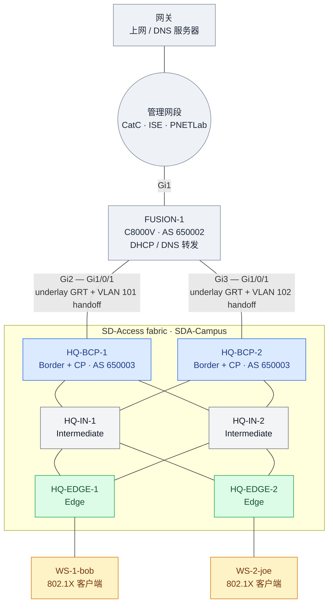

# SD-Access Lab Workbook（Network as Code 版）

用 Catalyst Center + ISE 搭一个 SD-Access fabric。CatC 上的配置（Task 8 起）不点 GUI，用 Terraform 模块 `netascode/nac-catalystcenter` 0.6.0 加 YAML 下发；CatC 管不到的 fusion（Catalyst 8000V）用 `netascode/nac-iosxe` 模块。任务按 NaC 的阶段排列：每个阶段一个配置文件、一次 apply。**所有参数以现网为准**。拓扑参考 Mason Reimert 的 SDA workbook v1.0。

状态：✅ 完成 ⏳ 进行中 ⬜ 未开始

## 0. 环境

### 拓扑

地址见下面的「地址规划」。



### 平台

| 项 | 值 |
|---|---|
| 仿真平台 | PNETLab，lab 文件 `/opt/unetlab/labs/sda-workbook/sda-workbook-catc323.unl`；仓库副本 [lab/sda-workbook-catc323.unl](lab/sda-workbook-catc323.unl)（启动配置里的 `enable secret` 已换成 `CHANGEME`，导入后自行修改） |
| 镜像 | 交换机 `cat9kvuadp-17.15.03`（4 vCPU / 18 GB）；FUSION-1 `c8000v-17.16.01a`（2 vCPU / 4 GB）；客户端 `linux-ubuntu-server-20.04`（需自备镜像） |
| Catalyst Center | 3.2.3 |
| ISE | 3.3.0，主机名 `ise.ccie.local`（standalone，PAN/MnT/PSN/pxGrid 同一节点） |
| 域名 | `ccie.local`。DNS 服务器上要有 ISE 的 A 记录，CatC 集成 ISE 时用 FQDN（Task 10） |

### 地址规划

| 用途 | 地址 |
|---|---|
| 管理 / 共享服务 | 192.168.1.0/24 |
| ├ 网关（上网、DNS 服务器） | 192.168.1.1 |
| ├ FUSION-1 Gi1 | 192.168.1.99（也是 NETCONF 管理地址） |
| ├ Catalyst Center | 192.168.1.133（GUI 和 API：`https://192.168.1.133`） |
| ├ ISE（`ise.ccie.local`） | 192.168.1.221 |
| └ PNETLab | 192.168.1.251 |
| Fusion ↔ Border underlay | 10.0.1.0/24（BCP-1）、10.0.2.0/24（BCP-2）；fusion .1，border 在 Vlan1 上 .2 |
| Border ↔ Intermediate | 172.16.11/12/21/22.0/24（BCP-1–IN-1、BCP-1–IN-2、BCP-2–IN-1、BCP-2–IN-2） |
| Intermediate ↔ Edge | 172.17.11/12/21/22.0/24（IN-1–EN-1、IN-1–EN-2、IN-2–EN-1、IN-2–EN-2） |
| Loopback0（RLOC） | BCP-1/2 9.9.9.11/.12，IN-1/2 9.9.9.21/.22，EDGE-1/2 9.9.9.31/.32 |
| Global pool `SDA-Campus` | 10.254.0.0/16 |
| VLAN 100 客户端（anycast GW .1） | 10.254.100.0/24 |
| L3 handoff BCP-1 / BCP-2（VLAN 101 / 102） | 10.254.251.0/30、10.254.252.0/30 |

### NaC 工具链

| 项 | 值 |
|---|---|
| Terraform | ≥ 1.15（本机 1.17.1） |
| Provider | `CiscoDevNet/catalystcenter` ~> 0.6.6 |
| 模块 | `netascode/nac-catalystcenter/catalystcenter` 0.6.0；`netascode/nac-iosxe/iosxe` 1.0.0（provider `CiscoDevNet/iosxe`，NETCONF） |
| 校验 | `nac-validate data/`（无 schema 时只查语法） |

---

## NaC 构建方法

### 仓库里有什么

| 文件 | 作用 |
|---|---|
| `main.tf` | 连接 CatC 的 provider；调用两个 NaC 模块（CatC 和 FUSION-1）并告诉它们读哪些 YAML（由变量 `stage` 控制，见「怎么分」） |
| `data/0N_*.nac.yaml` | 每个阶段的 YAML：`catalyst_center:` 开头的给 nac-catalystcenter，`iosxe:` 开头的（`00_fusion`、`03_fusion_handoff`）给 nac-iosxe。一个文件只能有其中一种 |
| `.env.example` | 所有密码的模板；复制成 `.env` 再填（已 gitignore），运行 Terraform 前 `source` |
| `terraform.tfvars.example` | 非敏感参数（CatC 地址），可选 |
| `lab/` | PNETLab 拓扑文件 |

YAML 只写「想要的状态」。模块把 YAML 翻译成 provider 资源，Terraform 把它和 state（上次建成的样子）对比，算出要新增、修改或删除什么，再调 CatC API 执行。

### Provider 和模块

两者是两层：**provider 是 Terraform 和某个平台对话的驱动，模块是写好的一套资源组合**。

| | Provider | 模块（module） |
|---|---|---|
| 是什么 | 插件程序（Go 编译的二进制） | 一个装满 `.tf` 文件的目录（HCL） |
| 管什么 | 怎么调某个平台的 API：登录、建对象、读回状态 | 建哪些资源、它们之间的先后、参数从哪来 |
| 提供什么 | 资源类型，例如 `catalystcenter_building`、`iosxe_bgp_neighbor` | 一套组合好的资源，加上对外的输入（`variable`） |
| 本实验 | `CiscoDevNet/catalystcenter`（CatC REST API）、`CiscoDevNet/iosxe`（设备 NETCONF） | `netascode/nac-catalystcenter`、`netascode/nac-iosxe` |
| 下载到 | `.terraform/providers/` | `.terraform/modules/` |

- **只用 provider 也能干活**：直接写 `resource "catalystcenter_building" ...`，每个参数、每个依赖自己写。
- **模块在 provider 之上再包一层**：NaC 模块读 YAML，翻译成几十上百个 provider 资源，并写好资源之间的 `depends_on`（例如 Stage 2 构建里讲的两道闸）。你描述「要什么」，不用管「调哪个资源、按什么顺序」。
- **模块自己不和设备通信**：它最终生成的还是 provider 资源，真正发 API 请求的始终是 provider。

类比 Ansible：provider 相当于连接插件加 `cisco.ios` 里的 `ios_config` 这类模块，Terraform 的模块相当于一个写好的 role。

**凭据走哪一层**，是这层关系最容易绕晕的地方：

- **provider 的登录凭据**：一般在根目录 `main.tf` 的 `provider` 块里配，模块沿用。CatC 就是这样，nac-catalystcenter 模块里没有 provider 块；provider 也能直接读环境变量 `CC_USERNAME` / `CC_PASSWORD`。
- **例外**：nac-iosxe 在模块**内部**自己写了 `provider "iosxe"` 块，根目录的配置进不去，凭据只能走 provider 自己读的环境变量 `IOSXE_USERNAME` / `IOSXE_PASSWORD`。
- **资源参数里的密码**：ISE 的管理员密码和 RADIUS 共享密钥不是 provider 登录用的，而是 CatC 拿去登录 ISE 的参数，所以要走模块的输入：YAML 里用 `!env ISE_PASSWORD` 从环境变量读，由模块交给 provider 资源。

三类都是环境变量，所以所有密码统一放在 gitignore 的 `.env` 里（模板 `.env.example`），运行 Terraform 前加载：`set -a; source .env; set +a`。环境变量不会写进 state，也不会写进 `.tfplan`。

### 为什么分阶段

Terraform 按资源之间的依赖排顺序，没有依赖的资源并行创建。模块里写好的依赖它知道（比如 building 在 area 之后建），但模块没有让 AAA 设置等 ISE 集成完成（`catalystcenter_aaa_settings` 的 `depends_on` 里没有 ISE 的资源）。而 CatC 要求 ISE 已集成才能设为 AAA，两者放在一次 apply 里会并行创建，AAA 先到就失败。

所以把有先后要求的对象分到不同阶段，前一阶段 apply 完、验证通过，再做下一阶段。顺带的好处是每次 apply 的范围小，plan 容易看懂，出了错也容易定位。

### 怎么分

`main.tf` 的变量 `stage` 决定读入哪些 YAML：Stage N 读入第 1 到 N 个文件。阶段是累加的，后面的阶段仍然包含前面的配置，已经建好的部分在 plan 里显示为无变化。`stage` 默认是 3（当前最后一个阶段）。

| Stage | Task | 配置文件 | Plan 文件 |
|---|---|---|---|
| Stage 0 | Task 1–6 underlay 与纳管；Task 7 FUSION-1 | 交换机上手工 CLI；FUSION-1 用 `data/00_fusion.nac.yaml`（nac-iosxe） | `stage0.tfplan` |
| Stage 1 | Task 8 网络层级、Task 9 地址池、Task 10 集成 ISE | `data/01_sites_pools.nac.yaml` | `stage1.tfplan` |
| Stage 2 | Task 11 AAA、Task 12 设备分配和 provision | `data/02_aaa_devices.nac.yaml` | `stage2.tfplan` |
| Stage 3 | Task 13–17 transit、VN、fabric site、设备角色、anycast gateway | `data/03_fabric.nac.yaml` + `data/03_fusion_handoff.nac.yaml`（fusion 一侧） | `stage3.tfplan` |
| Stage 4 | Task 18–25 微分段与身份 | 待定（CatC 部分 + `nac-ise`） | — |

### 每个阶段怎么做

流程固定四步：

```bash
terraform plan -var stage=N -out stageN.tfplan   # 1. 生成 plan，存成文件
terraform show stageN.tfplan | less -R           # 2. 检查：只应有新增，0 to change、0 to destroy
terraform apply stageN.tfplan                    # 3. 按检查过的 plan 执行
terraform plan -var stage=N                      # 4. 确认 No changes
```

- 第 3 步用存下来的 plan 文件，保证执行的就是第 2 步看过的内容。
- **已经建好的环境不要把 `stage` 调小**：少读的文件里的对象会被 plan 成删除。第 2 步看到 destroy 就停下。
- `*.tfplan` 已 gitignore，apply 后就过期（state 变了 Terraform 会拒绝再用），可随时删除。
- 每个阶段的前提、plan 里应该出现什么、apply 之后怎么验证，写在每个 Stage 末尾的「构建」里。第一次用 Terraform 前要准备 `.env` 并 `terraform init`，步骤在「构建（Stage 0）」。

### 约定

- **greenfield**：从一台刚部署好、只完成了 Stage 0 的 CatC 开始，站点、地址池、fabric 等全部由 Terraform 创建，不在 GUI 里手工建。
- **凭据不进仓库**：所有密码只放在 gitignore 的 `.env`（见「Provider 和模块」）。
- **state 不进仓库**：`terraform.tfstate` 已 gitignore，里面有 CatC 返回的对象 ID 等信息，放进公开仓库不合适。

---

## Stage 0 – Underlay、设备纳管与 FUSION-1（CLI / NaC）

### ✅ Task 1 – 数据中心路由

**目标**：共享服务网段能被 fusion 学到。

共享服务（CatC、ISE）直接在管理网段 192.168.1.0/24，FUSION-1 Gi1 接入，默认路由指向 192.168.1.1，BGP 里宣告 192.168.1.0/24。fusion 一侧的配置在 Task 7 的 `data/00` 里。

### ✅ Task 2 – Fusion 路由

**目标**：Fusion（AS 650002）和两台 border（AS 650003）在 GRT 建 eBGP，只做 underlay 可达，不涉及 overlay VN。

fusion 一侧由 Task 7 的 `data/00` 下发；border 一侧（`router bgp 650003`，邻居 10.0.1.1 / 10.0.2.1）在 border 上手工 CLI。

**验证**：fusion 上 `show ip bgp summary`，两个邻居 Established。

### ✅ Task 3 – Fabric 内部 underlay

**目标**：所有 fabric 内链路和 Loopback0 跑 IS-IS，loopback 全互通。

**原理**：SD-Access 的 underlay 只要求 RLOC（Loopback0 /32）可达、MTU 足够（VXLAN 多 50 字节）。IS-IS 是 LAN Automation 默认用的协议，不依赖 IP 就能起邻居。

**验证**：`show isis neighbors`；从任意节点 `ping 9.9.9.x source lo0`。

### ✅ Task 4 – 重分发

**目标**：border 上 IS-IS ↔ BGP 双向重分发，并把 border 自己的 loopback 宣告进 BGP（它们是本地直连，不会经 IS-IS 重分发出来）。

**验证**：从 edge 的 Loopback0 ping 通 CatC 和 ISE。

### ✅ Task 5 – 设备引导

**目标**：让 CatC 能纳管 BCP / EDGE 节点。每台配置：

- SNMP RW community
- `aaa new-model`，exec authorization 方法列表
- 本地最高权限用户（用户名、密码见 Bitwarden，**不写进本文件**）
- VTY 只允许 SSH、本地认证、privilege 15
- `netconf-yang`
- hostname，`ip domain name ccie.local`

### ✅ Task 6 – 发现设备

**目标**：用 CatC Discovery 把 fabric 设备加入 inventory，勾选 NETCONF。

**现网**：六台都在 inventory 里（BCP-1/2、IN-1/2、EDGE-1/2）。

### ✅ Task 7 – FUSION-1（Catalyst 8000V，nac-iosxe）

**目标**：fusion 用 NaC 管理：管理网段接入、默认路由、和两台 border 的 underlay eBGP、给 fabric 客户端的 DHCP 和 DNS 转发。到 border 的 L3 handoff（子接口和 VRF CORP 的邻居）在 Stage 3（Task 16）。

**为什么是 C8000V**：fusion 在 fabric 外，CatC 不管它。NaC 管 IOS-XE 用 `netascode/nac-iosxe` 模块，底层的 `CiscoDevNet/iosxe` provider 走 NETCONF（或 RESTCONF），需要 IOS-XE 17.x；经典 IOS（IOL 15.x）两者都没有。

**Day-0 bootstrap（console，一次性）**：NaC 要靠 NETCONF 连设备，而设备得先有管理地址、账号和 NETCONF，这一步只能在 console 上做。

1. 首次开机问 `Would you like to enter the initial configuration dialog?` 答 `no`。17.x 随后要求设置 enable secret（自己定），设完选 `2` 保存退出。
2. 建本地账号，用户名和密码就是 `.env` 里的 `IOSXE_USERNAME` / `IOSXE_PASSWORD`：

   ```
   enable
   configure terminal
   username <用户> privilege 15 secret <密码>
   ```

3. 其余不含凭据的部分（账号建好之后再开 AAA，否则 console 会被锁在外面）：

   ```
   pnpa service discovery stop          ! exec 模式；停掉开机自带的 PnP 发现
   configure terminal
   hostname FUSION-1
   ip domain name ccie.local
   interface GigabitEthernet1
    ip address 192.168.1.99 255.255.255.0
    no shutdown
   exit
   ip route 0.0.0.0 0.0.0.0 192.168.1.1
   crypto key generate rsa modulus 2048
   ip ssh version 2
   line vty 0 4
    transport input ssh
   exit
   aaa new-model
   aaa authentication login default local
   aaa authorization exec default local
   netconf-yang
   end
   write memory
   ```

   `crypto key generate` 要跑一会儿，粘贴时后面几行可能落在 exec 模式里报错，跑完再补。NETCONF 依赖 `aaa new-model`，开启后要等一两分钟 830 端口才通：`nc -z 192.168.1.99 830`。

**NaC**：`data/00_fusion.nac.yaml`，根键是 `iosxe:`，设备用 `host` 指向管理地址：

```yaml
iosxe:
  devices:
    - name: FUSION-1
      host: 192.168.1.99
      templates: [fusion-dhcp-dns]
      configuration:
        interfaces:
          ethernets:
            - type: GigabitEthernet
              id: "2"
              description: TO-HQ-BCP-1
              ipv4: { address: 10.0.1.1, address_mask: 255.255.255.0 }
        routing:
          static_routes:
            - prefix: 9.9.9.0           # fabric loopback 汇总，学不到的丢弃
              mask: 255.255.255.0
              next_hops:
                - interface_type: "Null"  # 要加引号，否则 YAML 当成空值
                  interface_id: "0"
          bgp:
            as_number: 650002
            neighbors:
              - { ip: 10.0.1.2, remote_as: 650003 }
            address_family:
              ipv4_unicast:
                networks:
                  - network: 192.168.1.0  # 有类 /24，IOS 不存掩码，这里也不写
                neighbors:
                  - ip: 10.0.1.2
        dhcp_pools:
          - name: CORP-VLAN-100
            network_number: 10.254.100.0
            network_mask: 255.255.255.0
            default_routers: [10.254.100.1]
            dns_servers: [192.168.1.99]
```

- 数据模型里没有的两条（`ip dhcp excluded-address`、`ip dns server`）用 CLI 模板（`type: cli`）原样下发。
- 一个 YAML 文件只能有一个根键（`iosxe:` 或 `catalyst_center:`），所以 fusion 的配置单独成文件，`main.tf` 给两个模块分别传文件列表。

**验证**：fusion 上 `show ip bgp summary` 两个邻居 Established，`show ip route bgp` 有 9.9.9.11–32 六条 /32；CatC Inventory 里设备恢复 Reachable。

### 构建（Stage 0）

前提：Task 1–6 完成，FUSION-1 做完 day-0 bootstrap。

**1. 准备 `.env`**（只在第一次做）

```bash
cp .env.example .env
```

| 变量 | 填什么 |
|---|---|
| `CC_USERNAME` / `CC_PASSWORD` | CatC 管理员账号（SUPER-ADMIN-ROLE） |
| `ISE_USERNAME` / `ISE_PASSWORD` | Task 10 准备第 6 步的 ISE 管理员账号 |
| `ISE_SHARED_SECRET` | RADIUS 共享密钥，自己定一个随机字符串。CatC 会把它同时写进交换机的 `radius server` 配置和 ISE 的 Network Device，两边自动一致，不用记 |
| `IOSXE_USERNAME` / `IOSXE_PASSWORD` | FUSION-1 上 bootstrap 建的本地账号 |

`.env` 已 gitignore。CatC 地址在 `main.tf` 有默认值，要改就复制 `terraform.tfvars.example`。

**2. 初始化**（只在第一次做，或模块、provider 版本变了之后）

```bash
terraform init        # 下载 provider 和两个 NaC 模块
terraform validate    # 检查语法
```

**3. Plan、检查、apply**（每个阶段、每个新终端都先加载 `.env`）

```bash
set -a; source .env; set +a
terraform plan -var stage=0 -out stage0.tfplan
terraform show stage0.tfplan | less -R
terraform apply stage0.tfplan
terraform plan -var stage=0     # 只剩 iosxe_commit 一项 change
```

plan 里应有 15 个新增，全是 `module.iosxe`：`iosxe_system`、3 个 `iosxe_interface_ethernet`、2 条 `iosxe_static_route`、`iosxe_bgp` 和地址族、2 × 2 个 BGP 邻居资源、`iosxe_dhcp`、`iosxe_cli`（CLI 模板）、`iosxe_commit`。

`iosxe_commit` 是「保存配置」这个动作（`save_config = true`，相当于 `write memory`），每次 plan 都显示 1 个 change，属于设计如此，其余资源应无变化。


---

## Stage 1 – 站点、地址池与 ISE 集成（`data/01_sites_pools.nac.yaml`）

### 准备：CatC 应用包（GUI，一次性）

新装的 CatC 只有核心包，fabric 相关的功能（fabric site、transit、VN 等）在 **SD Access** 包里。没装就跑 Stage 3，CatC 会直接拒绝：

```
NCSP11008: Package required to process the request was not found.
No application found for type 'ConnectivityDomain' and qualifier 'null'.
```

NaC 管不了这一步：provider 和模块用的是 CatC 公开的 Intent API（站点、设备、fabric、策略），装应用包属于 CatC 平台自身的生命周期，走 maglev 内部的系统 API，没有公开。和 ISE、C8000V 的 day-0 一样，只能手工做一次。

1. System → Software Management → Available Applications，勾选 **SD Access**（分类 Automation）→ Install。依赖包会一起装上，CatC 要能访问 Internet 下载。
2. 进度看 **View Release Activities** → 点执行 ID：依次是 Get Install release、Download Artifacts、Install Package。主页面上的百分比更新很慢（本实验一直停在 1%），以这里的步骤为准。

   > **安装要接近一小时，预留好时间。** 本实验（单节点 CatC 3.2.3，装 `sda` 和依赖包 `aca`）：12:11:34 开始，13:06:08（UTC）结束，**总共约 55 分钟**。其中 Download Artifacts 约 5.5 分钟，**Install Package 约 49 分钟**，期间 CatC 逐个停掉、更新再拉起 fusion 里的服务。
   >
   > 安装没结束前不要开始 Stage 3：部分 Intent API 会返回 502（本实验先是设备清单 `network-device`，恢复后又是模板项目 `template-programmer/project`），Terraform plan 会报 `StatusCode 502`。System 360 此时仍显示全部健康，因为被停掉的服务根本不在列表里。**以 Release Activities 里这次安装变成 Success 为准**，再跑 Stage 3。
3. 也可以在这一步顺手装后面要用的包，例如 Group Based Policy Analytics（Stage 4 可选）。

**验证**：View Installed Applications 里有 SD Access；左侧菜单 Provision → SD-Access 下的 Fabric Sites、Transits 能打开；System 360 里服务全部正常。

### ✅ Task 8 – 网络层级

**目标**：Area `USA` → Building `SDA-Campus`。

```yaml
catalyst_center:
  sites:
    areas:
      - name: USA
        buildings:
          - name: SDA-Campus
            country: United States   # provider 必填
            latitude: 37.41          # CatC 要求经纬度或地址二选一（NCND10502）
            longitude: -121.95
```

**原理**：模块把树展开成 `Global/USA`、`Global/USA/SDA-Campus`。`managed_sites` 为空且 `manage_global_settings: false` 时，YAML 里出现的所有站点都会被管理。

### ✅ Task 9 – IP 地址池

*地址池只依赖站点，和站点放在同一个文件、同一阶段下发。*

**目标**：Global pool `SDA-Campus` 10.254.0.0/16，Building 下预留三个子池。

```yaml
catalyst_center:
  sites:
    global:
      network_settings:
        ip_pools:
          - name: SDA-Campus
            ip_address_space: IPv4
            ip_pool_cidr: 10.254.0.0/16
    areas:
      - name: USA
        buildings:
          - name: SDA-Campus
            network_settings:
              ip_pools_reservations:
                - name: SDA-Campus-VLAN-100
                  global_pool: SDA-Campus
                  subnet: 10.254.100.0
                  prefix_length: 24
                  gateway: 10.254.100.1
                  dhcp_servers: [192.168.1.99]
                  dns_servers: [192.168.1.99]
                - name: SDA-Campus-L3-Handoff-1
                  global_pool: SDA-Campus
                  subnet: 10.254.251.0
                  prefix_length: 30
                - name: SDA-Campus-L3-Handoff-2
                  global_pool: SDA-Campus
                  subnet: 10.254.252.0
                  prefix_length: 30
```

客户端用 DHCP，服务器放在 FUSION-1（见下）。

#### 附：FUSION-1 上的 DHCP / DNS

**为什么放在 fusion**：SD-Access 的 DHCP 服务器一般在 fabric 外的共享服务区。流程：

1. Edge 作为 relay，GIADDR 填 anycast gateway（10.254.100.1），插入 option 82（含 edge 的 RLOC）；
2. 服务器按 GIADDR 选池，回包时**原样带回 option 82**；
3. Border 收到回包，根据 option 82 里的 RLOC 送回正确的 edge（因为所有 edge 共用同一个 GIADDR）。

所以服务器必须支持回显 option 82，且有到 10.254.100.0/24 的路由（Stage 3 之后经 handoff 学到）。dnsmasq 这类 DHCP 服务对 option 82 子选项（SD-Access 的 relay 会带 5 和 11）是否完整回显未经验证，没采用。

配置在 Task 7 的 `data/00_fusion.nac.yaml`：`dhcp_pools` 定义地址池，`ip dhcp excluded-address` 和 `ip dns server` 走 CLI 模板。

**验证**：`show ip dhcp pool`；Task 17 之后 `show ip dhcp binding`。

### ✅ Task 10 – 集成 ISE

*CatC 的全局系统设置，不依赖站点和地址池，和 `data/01` 同一阶段 apply；Stage 2 的 AAA 设置要求 ISE 已集成。*

**目标**：ISE 开 pxGrid，CatC 里加 ISE 为 AAA/PAN，重新 provision 后设备出现在 ISE 的 Network Devices 里。

**NaC**：`data/01_sites_pools.nac.yaml` 的 `system_settings`，凭据从 `.env` 读。

```yaml
catalyst_center:
  system_settings:
    authentication_and_policy_servers:
      ise:
        ip_address: 192.168.1.221
        fqdn: ise.ccie.local          # 必须和 ISE 证书的 CN 一致
        username: !env ISE_USERNAME
        password: !env ISE_PASSWORD
        password_version: 1
        shared_secret: !env ISE_SHARED_SECRET
        shared_secret_version: 1
        pxgrid_enabled: true
        retries: 3
        timeout: 4
        protocols:
          radius:
            authentication_port: 1812
            accounting_port: 1813
```

模块据此生成两个资源（[cc_system_settings.tf#L7-L51](https://github.com/netascode/terraform-catalystcenter-nac-catalystcenter/blob/v0.6.0/cc_system_settings.tf#L7-L51)），对应 GUI 里的两步：

- `catalystcenter_authentication_policy_server`：相当于 System → Settings → External Services → Authentication and Policy Servers → Add → ISE。填 ISE 的 IP 和 FQDN、RADIUS 端口、RADIUS 共享密钥、ISE 管理员账号，并打开 pxGrid。CatC 用这个账号登录 ISE，交换证书、建立信任。
- `catalystcenter_integrate_ise`：相当于 GUI 里弹出 ISE 证书时点「Accept」。接受证书后 CatC 和 ISE 完成 pxGrid 连接。

**凭据怎么传**：YAML 在公开仓库里，所以 ISE 的用户名、密码和 RADIUS 共享密钥用 `!env` 从环境变量读（值在 `.env`）。

- YAML 里写了 `password_version` 和 `shared_secret_version`，模块就改用 write-only 参数（`password_wo`、`shared_secret_wo`）：值发给 CatC，但不存进 state。代价是 Terraform 看不出值变没变，改了密码要把对应的 `*_version` 加 1，它才会重新下发。
- 没加载 `.env` 时 plan 会报 YAML 解析错误（`!env` 找不到变量）。

**准备（Terraform 之前手工做一次）**

CatC 集成 ISE 要求：ISE 开 ERS 读写和 pxGrid、用 FQDN 而不是 IP、两者之间没有代理（[Cisco：Integrate ISE 3.3 with Catalyst Center](https://www.cisco.com/c/en/us/support/docs/security/identity-services-engine-33/223162-integrate-ise-3-3-with-dnac.html)）。

1. **ISE 的主机名和域名**：CatC 用 FQDN 校验 ISE 的证书，所以 ISE 自己的主机名、域名必须和 `data/01` 里的 `fqdn` 一致（本实验 `ise.ccie.local`）。SSH 到 ISE CLI 检查：

   ```
   show running-config | include hostname|domain
   ```

   不一致就在 config 模式改 `hostname ise`、`ip domain-name ccie.local`。**改主机名会重启 ISE 应用服务（十几分钟）**，起来后 pxGrid 证书仍是旧主机名，要按排错记录重建 ISE Root CA 证书链，否则集成时报 FQDN 和证书 CN 不一致。

2. **DNS 记录**：CatC 要能把 `ise.ccie.local` 解析成 `192.168.1.221`。在 CatC 使用的 DNS 服务器上（本实验是网关 192.168.1.1）加一条 A 记录：

   | 名称 | 类型 | 地址 |
   |---|---|---|
   | `ise.ccie.local` | A | `192.168.1.221` |

   验证：`dig +short ise.ccie.local @192.168.1.1` 返回 `192.168.1.221`。CatC 用的是安装时配置的 DNS 服务器，要确认它就是这台。

3. **ISE 开 pxGrid**：Administration → System → Deployment → 勾选本节点 → Edit → 勾选 **pxGrid** → Save。单节点部署里 PAN、MnT、PSN、pxGrid 都在这一台上。

4. **ISE 开 ERS 读写**：Administration → System → Settings → API Settings → API Service Settings → 打开 **ERS (Read/Write)** → Save。CatC 通过 ERS API 在 ISE 里建 Network Device 和 SGT。

5. **pxGrid 自动批准**：Administration → pxGrid Services → Settings → 勾选 **Automatically approve new certificate-based accounts** 和 **Allow password based account creation** → Save。不勾的话，CatC 的 pxGrid 客户端要在 ISE 里手工 Approve。

6. **ISE 管理员账号**：用一个有 Super Admin 权限的账号（lab 里直接用 ISE 的 admin），它的用户名和密码填进 `.env`（见「构建（Stage 0）」）。

**验证**：CatC → System → Settings → External Services → Authentication and Policy Servers，ISE 状态 Active；CatC → System → System 360 → Externally Connected Systems 里 ISE 为 Available；ISE → Administration → pxGrid Services → Client Management → Clients 里 CatC 的客户端为 Enabled。Task 12 provision 之后，设备出现在 ISE 的 Network Devices 里。

### 构建（Stage 1）

前提：Stage 0 完成（`.env` 已准备、`terraform init` 已做）；Task 10 的「准备」1–6 都做完。

```bash
set -a; source .env; set +a
terraform plan -var stage=1 -out stage1.tfplan
terraform show stage1.tfplan | less -R
terraform apply stage1.tfplan
terraform plan -var stage=1     # 应为 No changes
```

plan 里应有：`catalystcenter_area`（USA）、`catalystcenter_building`（SDA-Campus）、`catalystcenter_ip_pool`、3 个 `catalystcenter_ip_pool_reservation`、`catalystcenter_authentication_policy_server.ise`、`catalystcenter_integrate_ise.ise`，以及几个 `terraform_data` 校验（只在 state 里）。`integrate_ise` 报 `WAITING_USER_INPUT` 时重新 plan、apply 一次（见排错记录）。

---

## Stage 2 – AAA 与设备 provision（`data/02_aaa_devices.nac.yaml`）

### ✅ Task 11 – Building 的 AAA 和 Telemetry 设置

**目标**：SDA-Campus 的 client AAA 指向 ISE `192.168.1.221`；打开有线客户端数据采集（IP Device Tracking）。

```yaml
            network_settings:
              client_and_endpoint_aaa:
                server_type: ISE
                protocol: RADIUS
                primary_ip: 192.168.1.221
              telemetry:
                wired_data_collection: true
```

- 只设 client/endpoint AAA（802.1X 认证用户和终端）；设备登录的 network AAA 本实验不配。ISE 必须先集成（Task 10），否则 CatC 拒绝把它设为 AAA。
- **`wired_data_collection` 是 CatC 3.x 建 fabric 的前置条件**（GUI：Design → Network Settings → Telemetry → Wired Client Data Collection）。没开的话，Stage 3 建 fabric site 时报 `NCSO20572`。要在设备 provision **之前**打开：provision 时 CatC 才会把 `device-tracking` 配置推下去。先 provision、后打开，加 edge 进 fabric 时报 `NCSO20573: Reprovisioning is required`，要把这些设备的 `state` 临时改成 `REPROVISION` apply 一次，再改回 `PROVISION`（provider 在 `reprovision = true` 时每次 apply 都会重新 provision）。

### ✅ Task 12 – 设备分配到站点并 provision

**目标**：六台设备分配到 SDA-Campus，四台 fabric 节点 provision。

**NaC**：`data/02_aaa_devices.nac.yaml` 的 `inventory.devices`

| 设备 | 角色 | 状态 |
|---|---|---|
| HQ-BCP-1/2 | BORDER ROUTER | PROVISION |
| HQ-EDGE-1/2 | ACCESS | PROVISION |
| HQ-IN-1/2 | DISTRIBUTION | ASSIGN（只跑 underlay，分配到站点但不 provision） |

- 模块按 CatC 里的 hostname 找设备。设备配了 `ip domain name ccie.local`，CatC 显示的是 `HQ-BCP-1.ccie.local`，所以用 `fqdn_name` 写全名，`name` 写短名。
- `device_ip` 是发现时用的 Loopback0。
- 这里的 provision 是 CatC 对单台设备的 provision（`catalystcenter_provision_device`）：把站点的网络设置（AAA、DHCP/DNS 等）推到设备上，之后设备出现在 ISE 的 Network Devices 里。它是加入 fabric（Task 16）的前提，但不是 fabric provision。
- `device_role` 是 Inventory 里的拓扑角色，只影响拓扑图层次，不是 fabric 角色。
- Intermediate 不加入 fabric、不认证终端，所以只分配不 provision。

**验证**：Inventory 里 4 台 fabric 节点 Provision Status 为 Success；`show run | s aaa|radius` 能看到 ISE。

### 构建（Stage 2）

前提：Stage 1 已 apply，并且 Task 10 的验证都通过（CatC 里 ISE 状态 Active）。

```bash
terraform plan -var stage=2 -out stage2.tfplan
terraform apply stage2.tfplan
terraform plan -var stage=2     # 应为 No changes
```

plan 里应有：1 个 `catalystcenter_aaa_settings`、1 个 `catalystcenter_assign_device_to_site`、6 个 `catalystcenter_device_role`、4 个 `catalystcenter_provision_device`，以及 `time_sleep` 和两道闸 `terraform_data`（见下）。provision 每台约 3–4 分钟。apply 中断时，已完成的资源已写进 state，重新 plan 只剩没完成的部分。

#### plan 里不对应 CatC 对象的资源：两道「闸」

`terraform plan` 里会看到几个不对应任何 CatC 对象的资源：`terraform_data.before_fabric_template_deployments`、`terraform_data.fabric_configuration_complete` 和几个 `time_sleep`。`terraform_data` 是 Terraform 自带的空资源，只存在于 state 里，模块用它当**闸门**控制先后：

```
前置模板 → 闸 1 → 建 fabric → 闸 2 → 后置模板
```

**闸 1**：所有「建 fabric 之前要推的模板」推完，闸才开（[cc_templates.tf#L661-L665](https://github.com/netascode/terraform-catalystcenter-nac-catalystcenter/blob/v0.6.0/cc_templates.tf#L661-L665)）：

```hcl
resource "terraform_data" "before_fabric_template_deployments" {
  input = {
    for key, deployment in catalystcenter_deploy_template.regular_template_deploy_before_fabric : key => deployment.id
  }
}
```

fabric site 依赖这一道闸，不用逐个依赖每个模板部署（[cc_fabric.tf#L260-L267](https://github.com/netascode/terraform-catalystcenter-nac-catalystcenter/blob/v0.6.0/cc_fabric.tf#L260-L267)）：

```hcl
resource "catalystcenter_fabric_site" "fabric_site" {
  # ...
  depends_on = [ /* building、AAA 设置等 */, terraform_data.before_fabric_template_deployments]
}
```

**闸 2**：fabric 的所有资源（transit、VN、anycast gateway、fabric 设备、L3 handoff……）建完，闸才开（[cc_fabric.tf#L1388-L1425](https://github.com/netascode/terraform-catalystcenter-nac-catalystcenter/blob/v0.6.0/cc_fabric.tf#L1388-L1425)）：

```hcl
resource "terraform_data" "fabric_configuration_complete" {
  depends_on = [
    catalystcenter_transit_network.transit,
    catalystcenter_fabric_l3_virtual_network.l3_vn,
    catalystcenter_anycast_gateway.anycast_gateway,
    catalystcenter_fabric_device.border_device,
    # ……共三十多项
  ]
}
```

「建 fabric 之后才推」的模板依赖闸 2，所以一定等 fabric 全部建完（[cc_templates.tf#L667-L709](https://github.com/netascode/terraform-catalystcenter-nac-catalystcenter/blob/v0.6.0/cc_templates.tf#L667-L709)）：

```hcl
resource "catalystcenter_deploy_template" "regular_template_deploy_after_fabric" {
  # ...
  depends_on = [ /* provision 等 */, terraform_data.fabric_configuration_complete]
}
```

本实验没有模板，两道闸都是空的，一建就开。`time_sleep.provision_device_wait` 则是 provision 之后固定等一会儿，让 CatC 处理完任务。state 里那些 `*_validation` 也是 `terraform_data`，带 precondition，配置会造成危险改动（比如误删 VN）时让 plan 直接报错。

---

## Stage 3 – Fabric（`data/03_fabric.nac.yaml`）

transit 和 L3 VN 定义在 `fabric` 下（全局），fabric site 及其 VN、设备角色、anycast gateway 定义在 `fabric.fabric_sites[]` 下。Task 13–17 在一个文件里、一次 apply。fusion 一侧已在 Stage 0（Task 7）配好，apply 之后 handoff 的 BGP 会话自动起来。

### ✅ Task 13 – Transit

**目标**：IP-based transit `TO-FUSION`，AS 650002。

```yaml
catalyst_center:
  fabric:
    transits:
      - name: TO-FUSION
        type: IP_BASED_TRANSIT
        routing_protocol_name: BGP
        autonomous_system_number: "650002"
```

### ✅ Task 14 – VN

**目标**：L3 VN `CORP`，关联 fabric site。

```yaml
  fabric:
    l3_virtual_networks:
      - name: CORP
    fabric_sites:
      - name: Global/USA/SDA-Campus
        l3_virtual_networks:
          - CORP
```

### ✅ Task 15 – Fabric site

**目标**：SDA-Campus 建 fabric site，认证模板 Closed Authentication，控制平面用 LISP/BGP，不用 Pub/Sub。

```yaml
    fabric_sites:
      - name: Global/USA/SDA-Campus
        authentication_template:
          name: Closed Authentication
        pub_sub_enabled: false
```

### ✅ Task 16 – Fabric 设备角色与 L3 handoff

| 设备 | 角色 | Handoff |
|---|---|---|
| HQ-BCP-1 | Border + Control Plane | Gi1/0/1，VLAN 101，10.254.251.1/30 ↔ fusion .2，local AS 650003 → 650002 |
| HQ-BCP-2 | Border + Control Plane | Gi1/0/1，VLAN 102，10.254.252.1/30 ↔ fusion .2，local AS 650003 → 650002 |
| HQ-EDGE-1/2 | Edge | — |

```yaml
        fabric_devices:
          - name: HQ-BCP-1             # 和 data/02 inventory.devices[].name 一致
            fabric_roles: [BORDER_NODE, CONTROL_PLANE_NODE]
            border_types: [LAYER_3]
            local_autonomous_system_number: "650003"
            default_exit: true
            import_external_routes: true
            l3_handoffs:
              - ip_transit_name: TO-FUSION
                interfaces:
                  - name: GigabitEthernet1/0/1
                    virtual_networks:
                      - name: CORP
                        vlan: 101
                        local_ip_address: 10.254.251.1/30   # border
                        peer_ip_address: 10.254.251.2/30    # fusion
          # HQ-BCP-2 同上，VLAN 102、Handoff-2
          - name: HQ-EDGE-1
            fabric_roles: [EDGE_NODE]
```

- `import_external_routes: true`：把 fusion 学到的 BGP 路由导入 fabric 控制平面（GUI 里对应不勾选「Do not import external routes」）。
- handoff 要指定 transit、外部接口和地址：`ip_transit_name`、`interfaces[].name`、`local_ip_address` / `peer_ip_address`。地址也可以只给一个池（`external_handoff_pool`）让 CatC 分配，但那样 border 拿哪个地址要等 apply 之后才知道；写死地址（取自 Stage 1 预留的 `SDA-Campus-L3-Handoff-1/2`），fusion 一侧就能用同样的地址一起建。

**Fusion 一侧**：`data/03_fusion_handoff.nac.yaml`（nac-iosxe），和 border 一侧在同一次 apply 里建。fusion 不做 VRF：GRT 的路由全部漏进 CORP VN。

```yaml
iosxe:
  devices:
    - name: FUSION-1
      configuration:
        interfaces:
          ethernets:
            - type: GigabitEthernet
              id: "2.101"                     # 子接口：Gi2 上的 VLAN 101
              encapsulation_dot1q_vlan_id: 101
              ipv4: { address: 10.254.251.2, address_mask: 255.255.255.252 }
        routing:
          bgp:
            neighbors:
              - { ip: 10.254.251.1, remote_as: 650003 }   # = border 的 local_ip_address
            address_family:
              ipv4_unicast:
                neighbors:
                  - ip: 10.254.251.1
```

`data/00` 和这个文件里都有 `name: FUSION-1`，模块按名字把两份配置合并成一台设备。
- Border 连 fusion 的口必须是 switchport（trunk），CatC 才能在上面加 handoff VLAN 的 SVI。
- 部署很慢（可能要半小时左右），期间 CatC 里设备显示不可达属正常，进度看 Activities → Tasks。

### ✅ Task 17 – Anycast gateway

**目标**：CORP 里的 VLAN 100，使用 `SDA-Campus-VLAN-100`（模块按 `ip_pool_name` 关联）。

```yaml
        anycast_gateways:
          - l3_virtual_network: CORP
            ip_pool_name: SDA-Campus-VLAN-100
            vlan_id: 100
            vlan_name: VLAN_100
```

**验证**：edge 上 `show run int vlan 100` 有 `ip helper-address 192.168.1.99`；客户端拿到 10.254.100.x（Task 24 之后）。

### 构建（Stage 3）

前提：CatC 已装 SD Access 包（Stage 1 的「准备：CatC 应用包」）；Stage 2 已 apply。CatC → Provision → Inventory，把站点切到 `Global/USA/SDA-Campus`，HQ-BCP-1/2、HQ-EDGE-1/2 的 Provision Status 都是 Success。

```bash
set -a; source .env; set +a
terraform plan -var stage=3 -out stage3.tfplan
terraform apply stage3.tfplan
terraform plan -var stage=3     # 只剩 iosxe_commit 一项 change
```

plan 里应有 18 个新增、1 个 change（`iosxe_commit`）：

- CatC 12 个：`catalystcenter_transit_network`、`catalystcenter_fabric_site`、`catalystcenter_update_authentication_profile`（Closed Authentication）、`catalystcenter_fabric_l3_virtual_network`（CORP）、2 个 `border_device`、2 个 `edge_device`、2 个 `catalystcenter_fabric_l3_handoff_ip_transits`、1 个 `catalystcenter_anycast_gateway`，以及 1 个 `terraform_data` 校验；
- FUSION-1 6 个：2 个子接口（`ethernet_sub`）、2 × 2 个 BGP 邻居资源。

apply 可能要半小时左右。在 `tmux` 里跑，避免终端关闭把 Terraform 中断；中断了就重新 plan、apply。如果 Stage 2 provision 时还没打开 `wired_data_collection`，第一次 apply 会在 fabric site 或 edge 上失败（`NCSO20572` / `NCSO20573`），按 Task 11 补上后重新 plan、apply，已建好的资源不会重复建。

**apply 成功不等于配置已经下发到设备上。** provider 只等 CatC 接受请求，CatC 下发失败（比如那一刻连不上设备）时 Terraform 照样报成功。所以 apply 之后要上设备逐台核对：

- Edge（两台都要看）：`show vrf brief` 里有 `CORP`（含 Vl100 和 LI0.4099）；`show ip interface brief | include Vlan100|LISP` 里 Vlan100 是 10.254.100.1（没有客户端时 protocol 是 down，正常）；`show lisp session` 里到 9.9.9.11、9.9.9.12 两个会话都是 Up。
- Border：`show ip bgp vpnv4 vrf CORP summary` 里到 fusion 的邻居（BCP-1 是 10.254.251.2，BCP-2 是 10.254.252.2）Established；`show ip route vrf CORP 192.168.1.0` 是从 fusion 学来的。
- Fusion：`show ip bgp summary` 里 10.254.251.1、10.254.252.1 两个邻居 Established，`show ip bgp` 看到 10.254.100.0/24。

设备上没配置时，先看 CatC 的审计日志（Activities → Audit Logs，或 `GET /dna/data/api/v1/event/event-series/audit-logs`）里有没有 `Service request processing has failed`。

---

## Stage 4 – 微分段与身份（ISE / CatC）

*NaC 方案待定，确定后可能按 CatC / ISE 两个配置拆分重排。*

### ⬜ Task 18 – TrustSec 迁移

把 TrustSec 策略管理从 ISE 迁到 CatC（Group-Based Policy）。

### ⬜ Task 19 – 安全策略

| SRC \ DST | Employees | Contractors | Developers |
|---|---|---|---|
| Employees | `[ ]` | `[ ]` | `[ ]` |
| Contractors | `[ ]` | `[ ]` | `[ ]` |
| Developers | `[ ]` | `[ ]` | `[ ]` |

`[按实验设计填 permit / deny]`

### ⬜ Task 20 – ISE 用户组

`SDA_Employees`、`SDA_Contractors`、`SDA_Developers`

### ⬜ Task 21 – ISE 本地用户

| 用户 | 组 | 客户端 |
|---|---|---|
| bob | SDA_Employees | WS-1-bob |
| joe | SDA_Contractors | WS-2-joe |
| susan | SDA_Contractors | `[现网无此客户端]` |
| kim | SDA_Developers | `[现网无此客户端]` |

密码不写进本文件。

### ⬜ Task 22 – 授权结果

Access-Accept，下发 VLAN 100。

### ⬜ Task 23 – Policy set

停用默认 policy set；新建一个用本地身份库认证、按身份组匹配并下发对应 SGT 的 policy set。

### ⬜ Task 24 – 客户端 802.1X

Linux 客户端装 `wpasupplicant`，用 PEAP 配置 `/etc/wpa_supplicant/wpa_supplicant.conf`，然后：

```bash
sudo wpa_supplicant -c /etc/wpa_supplicant/wpa_supplicant.conf -D wired -i <fabric 侧网卡>
sudo dhclient <fabric 侧网卡>
```

地址用 DHCP 获取（Task 9 附录）。

### ⬜ Task 25 – 验证

- 按 Task 19 的矩阵互 ping，确认策略生效；
- 客户端 ping ISE、CatC，验证 handoff；
- Edge：`show lisp instance-id * ethernet database`、`show cts role-based permissions`、`show access-session`。

---

## 附加任务（可选）

- **待探索：LAN Automation 做 underlay**。只手工配 border 作为种子设备，intermediate 和 edge 由 CatC 通过 PnP 自动生成 IS-IS underlay 并纳管，取代 Task 3–6 的手工部分；NaC 用模块的 `cc_lan_automation.tf`。需先验证 cat9kv 是否支持。

- **待探索：全新 ISE 用 ZTP bootstrap**。ISE 3.1 起支持 Zero-Touch Provisioning：第一次开机前把 key=value 配置交给安装程序，跳过交互式 `setup`。本 lab 的 ISE 是装好后改 hostname / domain 的，所以踩了 pxGrid 证书 CN 不一致的坑（见排错记录）；用 ZTP 的话，主机名、内部 CA 和 pxGrid 证书一开始就是 `ise.ccie.local`，API 也直接开好。
  1. **建 VM**：Terraform（`proxmox-vm` 模块）按 ISE 规格建 VM，挂安装 ISO。
  2. **ZTP 配置**：常见字段 `hostname`、`ipv4_addr`、`ipv4_mask`、`ipv4_default_gw`、`domain`、`primarynameserver`、`ntpserver`、`timezone`、`username` / `password`，以及服务开关 `ersapi`、`openapi`、`pxGrid`、`pxGrid_Cloud`。打包成 `.img` 挂到**第二个光驱**，或者在 OVA / 云部署里用 user data 传入。密码不进 Git，和 `terraform.tfvars` 一样由用户填。
  3. **起来之后**：策略对象（Task 20–23）用 `nac-ise` / `CiscoDevNet/ise` provider；persona、证书、多节点注册用 OpenAPI 或 Ansible `cisco.ise`；CatC 集成就是 Task 10 的 `system_settings`。仍需手工的主要是 license（评估版 90 天）。
  - 注意：字段名和镜像文件名（`ise-ztp.img` / `ise_config.img`）因版本而异，以对应版本的安装指南为准；没找到 KVM / Proxmox 专门的 ZTP 步骤，`.img` 怎么挂需按安装指南 KVM 章节验证；社区报告过 VMware 上 UEFI 卡住、改 BIOS 才好。
  - 参考：[ISE ZTP（Cisco Community）](https://community.cisco.com/t5/security-documents/ise-zero-touch-provisioning-ztp/ta-p/4541606)、[SNS VM 须知](https://community.cisco.com/t5/security-knowledge-base/ise-what-we-need-to-know-about-sns-vm/ta-p/5274022)、[Deploy ISE 3.4](https://www.cisco.com/c/en/us/support/docs/security/identity-services-engine-34/223285-deploy-identity-services-engine-ise.html)、[VMware ZTP 卡住](https://community.cisco.com/t5/network-access-control/ise-3-1-auto-install-on-vmware-with-iso-hangs/m-p/4871993)。

- 第二个 VN `Guest`，只能访问 fusion 之外的一个地址；
- 不支持 802.1X 的主机：用 host onboarding 给端口静态 SGT + open auth（不用 CLI）；
- handoff 改为 VRF-aware，在 fusion 上选择性泄漏一条 GRT 路由进 fabric；
- 让流量优先走 BCP-1，回程也一致。

## 排错记录

| 日期 | 现象 | 原因 / 处理 |
|---|---|---|
| 2026-11-11 | `terraform plan`：Unable to find username | 运行 plan 的 shell 里没有 `CC_USERNAME`；provider 只认 `CC_*` 变量名 |
| 2026-11-11 | apply 时 building 报 400 `NCND10502: Either latitude/longitude or address is ...` | CatC API 要求 building 带经纬度或地址；YAML 加 `latitude` / `longitude` |
| 2026-11-11 | 作者环境里有之前在 GUI 手工建的 USA / SDA-Campus，与 greenfield 前提不符 | 一次性清理：`terraform destroy`，再在 GUI 删掉残留，回到干净状态后按正常流程重跑。（另一种做法是 provider 的 `allow_existing_on_create` 接管存量对象，属于 brownfield 迁移，本实验不用） |
| 2026-11-11 | stage1.tfplan 只有 7 个 `terraform_data` | plan 中途出错（plan 文件里 `errored: true`），不是 YAML 没读到；要看 plan 的完整报错输出 |
| 2026-11-11 | `catalystcenter_integrate_ise`：`WAITING_USER_INPUT ... certificate ... not yet trusted` | 时序问题：接受证书的请求在 CatC 进入等待确认状态之前就发出了。再 apply 一次即可 |
| 2026-11-11 | `catalystcenter_integrate_ise`：`FQDN ise.ccie.local doesn't match the common name contained in the system certificate` | ISE 改过主机名，admin 证书（443）已是新 CN，但 pxGrid 证书（8910）仍是旧主机名，由旧的内部 CA 签发。ISE → Certificates → CSR → 用途选 ISE Root CA → Replace ISE Root CA Certificate chain；然后按报错要求重建 CatC 里的 ISE 条目：`terraform apply -replace='module.catalyst_center.catalystcenter_authentication_policy_server.ise[0]' -target=module.catalyst_center.catalystcenter_integrate_ise.ise`。检查方法：`openssl s_client -connect <ise>:8910` 看 CN |
| 2026-11-11 | C8000V 首次开机卡在 `Enter enable secret:` | 17.x 拒绝默认空 enable secret，必须设置；之后选 `2` 保存。选了 `0` 也能进 `Router>`，只是没保存，之后在 config 模式补 `enable secret` |
| 2026-11-11 | C8000V Gi1 开机自己拿了 DHCP 地址，并连上 `devicehelper.cisco.com` | 出厂的 PnP 发现在工作。exec 模式 `pnpa service discovery stop`，再配静态地址 |
| 2026-11-11 | 粘贴 bootstrap 时 `crypto key generate` 之后的几行报 `Invalid input` | 生成密钥期间退回了 exec 模式。密钥生成完再补那几行 |
| 2026-11-11 | `netconf-yang` 已开，但 830 端口不通 | NETCONF 依赖 `aaa new-model`；开 AAA 后等一两分钟（`show netconf-yang status`、`nc -z <ip> 830`） |
| 2026-11-11 | nac-iosxe：`multiple architecture keys found: "iosxe" and "catalyst_center"` | 一个 YAML 文件只能有一个根键。fusion 的配置放进单独的文件（`data/00_fusion`、`data/03_fusion_handoff`），`main.tf` 给两个模块分别传文件列表 |
| 2026-11-11 | 静态路由 `next_hops[0].next_hop` required | YAML 把 `interface_type: Null` 解析成空值，要写成 `"Null"` |
| 2026-11-11 | apply 后 BGP `network 192.168.1.0 mask 255.255.255.0` 每次 plan 都要改 | 有类 /24，IOS 存成不带掩码的 `network 192.168.1.0`，读回来对不上。YAML 里去掉 `mask` |
| 2026-11-11 | `iosxe_commit` 每次 plan 都显示 `save_config = false -> true` | 设计如此：它代表「保存配置」这个动作，每次 apply 都执行一次 `write memory`。其余资源无变化即算收敛 |
| 2026-11-11 | Stage 3：transit / fabric site 报 `NCSP11008 ... No application found for type 'ConnectivityDomain'` | CatC 没装 SD Access 包。按 Stage 1「准备：CatC 应用包」装好再跑 |
| 2026-11-11 | 装 SD Access 包后 plan 报 `StatusCode 502`（`network-device`、`template-programmer/project`），System 360 却显示全部健康 | 安装还没结束（本实验整个安装约 55 分钟），安装流程停掉了 fusion 里的服务。Kibana 里 Kong 日志是 `connect() failed (111: Connection refused) while connecting to upstream`，inventory 服务最后一条日志是 `Stopping`。等 Release Activities 显示 Success 再跑；健康检查要带认证，未认证请求会被 Kong 直接回 401 |
| 2026-11-12 | Stage 3：fabric site 报 `NCSO20572: Before creating a new Fabric Site ... enable wired client IP Device Tracking` | CatC 3.x 的新前置条件。building 的 `network_settings.telemetry.wired_data_collection: true`（Task 11） |
| 2026-11-12 | Stage 3：edge 加入 fabric 报 `NCSO20573: Reprovisioning is required on device ... for applying wired client IP Device Tracking` | 设备在打开 IP Device Tracking 之前 provision 过。把 edge 的 `state` 临时改成 `REPROVISION` apply 一次，再改回 `PROVISION` |
